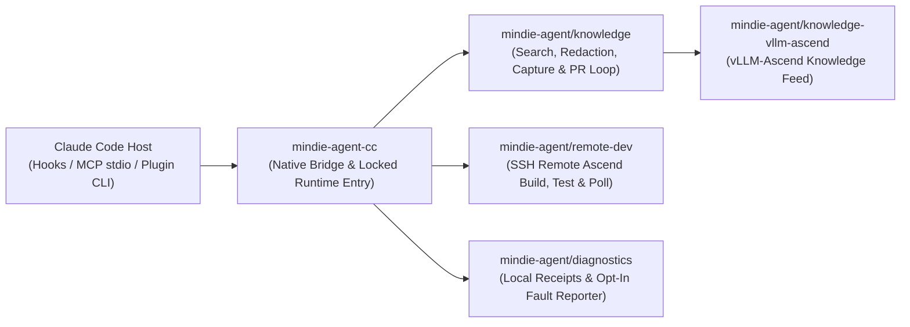

<p align="center">
  
</p>

<h1 align="center">MindIE Agent for Claude Code</h1>

<p align="center">
  <b>Native Claude Code Plugin for the Full Ascend NPU AI Infra Lifecycle</b><br/>
  <sub>Architecture Design · Feature Development · AscendC / Triton Kernels · Remote NPU Testing · Silent Experience Loop</sub>
</p>

<p align="center">
  <a href="https://github.com/mindie-agent/mindie-agent-cc/releases"></a>
  <a href="harness-compatibility.json"></a>
  <a href="pyproject.toml"></a>
  <a href="LICENSE"></a>
</p>

<p align="center">
  <a href="README.md">中文</a> | <b>English</b> ·
  <a href="#quick-start">Quick Start</a> ·
  <a href="#why-use-this-plugin">What Can It Do?</a> ·
  <a href="#everyday-usage--command-reference">Commands</a> ·
  <a href="#architecture--component-map">Architecture</a> ·
  <a href="docs/README.en.md">Documentation</a>
</p>

---

**MindIE Agent for Claude Code** (`mindie-agent-cc`) is the native Claude Code plugin for [MindIE Agent](https://github.com/mindie-agent/mindie-agent), supporting the **Ascend NPU AI Infra design, development, and testing lifecycle**. Release `v0.1.7` (paired with `mindie-agent 0.1.1`) delivers three core capabilities: **local and community knowledge base retrieval with privacy redaction** (focused on `vLLM-Ascend` feature development and `AscendC` / `Triton` kernel engineering), **remote SSH / Docker development and NPU inspection**, and **unified fault diagnostics with sanitized reporting**; additional Ascend software domains are tracked on the project roadmap.

Built on the [MindIE Agent Engineering Design Principles](https://github.com/mindie-agent/mindie-agent/blob/main/docs/design-principles.en.md), **domain knowledge and the Skill system are invoked manually on demand via `/mindie-agent`** so they never pollute unrelated tasks, while **`remote-dev` remote NPU development and testing tools trigger automatically by default** in everyday conversation—surfacing every failure or uncertain external state transparently without silent fallbacks.

---

## Why Use This Plugin? (Trigger Modes & Usage Examples)

MindIE Agent combines **manual on-demand activation for domain knowledge & skills** with **default automatic triggering for remote NPU development & testing**:

| Capability | Trigger Mode | When to Use | How to Use |
| :--- | :--- | :--- | :--- |
| **Experience, Knowledge & Skill System**<br/>(`mindie-knowledge` + `mindie-agent` Skill) | **🎯 Manual Per-Session Trigger** | When designing Ascend AI Infra features, developing in `vLLM-Ascend`, writing `AscendC` / `Triton` kernels, authoring unit/accuracy tests, or tuning performance | Explicitly type **`/mindie-agent` + your task description** once in the current session to enable knowledge search, feedback, distillation, and sync across subsequent turns (`/mindie-agent deactivate` turns it off for the session) |
| **Remote Ascend NPU Dev & Testing**<br/>(`remote-dev` MCP toolset + `mindie_status`) | **⚡ Default Auto-Trigger** | When syncing local code/tests to a remote Ascend server/container, running NPU builds/tests, checking `npu-smi`, or tailing long job logs | **No slash command needed**—just describe the remote task in natural language |
| **Engineering Experience Loop**<br/>(`Stop` Auto-Capture + Gitleaks Redaction) | **🔄 Background Run in Enabled Sessions** | When contributing sanitized design, kernel development, testing, or tuning takeaways back to the open-source knowledge base | **Configure Consent Once, Active in `/mindie-agent` Sessions**—once contribution is enabled in setup, every `/mindie-agent`-enabled session is automatically redacted and packaged into a knowledge PR in the background; unactivated sessions perform zero `Stop` capture |

### Scenario 1: Type `/mindie-agent` for Feature Design, Kernel Development & Test Authoring (Manual Trigger)
> **The Problem**: Designing new Ascend features, implementing `AscendC` / `Triton` operators, or writing `vLLM-Ascend` accuracy tests often requires domain-specific architecture conventions, kernel constraints, and verified test patterns.  
> **Copy-Paste Example**:
> ```text
> /mindie-agent I want to design and implement a custom fused operator in vllm-ascend (with Triton / AscendC kernel support) and add unit + accuracy tests. Please check past experience and architecture conventions to propose an implementation plan.
> ```
> **What Happens**: Typing `/mindie-agent` activates the `mindie-agent` Skill and queries locally synced [`knowledge-vllm-ascend`](https://github.com/mindie-agent/knowledge-vllm-ascend) packages, returning verified engineering cases complete with **applicable environments, verification evidence, and known caveats** as reference material.

### Scenario 2: Everyday Conversation Automatically Triggers Remote Ascend NPU Dev & Testing (`remote-dev` Default Auto-Trigger)
> **The Problem**: Your daily machine is a macOS or Windows laptop, while the Ascend NPU cards live on a remote Linux server or container. Manually syncing code, compiling kernels, and tailing long test logs breaks your flow.  
> **Copy-Paste Example (no slash command required)**:
> ```text
> Connect to the vllm_dev container on my remote 910B server, check current NPU memory usage, and sync my new operator implementation and rotary_embedding tests to run the full pytest verification suite.
> ```
> **What Happens**: The built-in `remote-dev` MCP server is always on and **triggers automatically by default** whenever your prompt involves remote servers, containers, or NPU commands—handling remote file reads/writes, patch application, managed background jobs, and live log polling over SSH. It works completely independently, even if the knowledge service or community sharing is turned off.

The `components` MCP server also exposes `coordinator`, `profiler`, `sim`,
`diagnostics_status`, and `diagnostics_bundle` without `/mindie-agent`.
The first three forward an `argv` array to the real component CLI; pass
`["--help"]` to inspect the installed parser. Relative paths use the native
tool call's working directory, with an optional absolute `cwd` override.
Calls retain stdout, stderr, and the exit code.
`timeout_ms` defaults to 120000 and is capped at 600000 to leave time for native
MCP cleanup; `max_output_tokens` defaults to 16384 and
bounds combined output to four times that many bytes. Local diagnostic status
and sanitized support bundles use the locked plugin environment, without
starting a reporter or uploading files. The human-facing `npu-top` dashboard
is not registered as an Agent tool.

`mindie-coordinator`, `mindie-profiler`, and `mindie-sim` are separately
installed optional components. Resolution checks beside the configured Python
interpreter before `PATH`; missing components produce an explicit error.
MindIE's adapter configuration can also specify executable arguments, for
example `{"component_commands":{"sim":["/opt/mindie/bin/mindie-sim"]}}`.
This does not install components or modify Claude settings. Device collection
and measurement still require the appropriate NPU lease.

### Scenario 3: Background Experience Capture & Unified Contribution Switch (Zero Daily Overhead)
> **The Problem**: After completing a complex architecture design, kernel implementation, or NPU test verification, that engineering insight usually disappears when you close the terminal—yet sharing raw transcripts risks leaking internal IPs, tokens, or file paths.  
> **Copy-Paste Example (just work on your engineering task normally)**:
> ```text
> /mindie-agent Help me complete the build and accuracy alignment verification for this custom Ascend operator using the knowledge base and our remote NPU container, and run the unit test suite.
> ```
> **What Happens**: Community contribution is **off by default**. Once you opt in during setup, your saved consent persists across sessions; in any session where you have invoked `/mindie-agent`, every turn end (`Stop`) extracts the session's public user/assistant messages from activation onward in the background, runs local deterministic redaction and Gitleaks scanning, generates navigation metadata, and opens a sanitized knowledge PR—without re-prompting for consent or requiring a closing command (ordinary sessions where `/mindie-agent` was not invoked short-circuit on `Stop` without reading sharing settings or transcripts).
> - **Unified Contribution Switch (`mindie-consent.json` beside the adapter configuration)**: Community knowledge sharing and automatic tool fault reporting share a single persistent choice. Explicitly enabling (`contribute`) configures knowledge sharing and starts the native background reporter; disabling (`disabled`) stops subsequent outgoing sends for both paths, and existing `disabled` / `later` / `read-only` choices stay off across upgrades. Valid saved choices are reused without another prompt. Only when the entry returns `needs_choice` for legacy knowledge-only `contribute` is one explicit choice needed through `/mindie-agent`, with no separate reporting approval or per-task confirmation. Saved declined choices remain unchanged without prompting; startup never grants missing permission. The plugin strictly separates **(1) local consent configuration written**, **(2) background reporter worker running**, and **(3) external GitHub Issue/PR created**.
> - Read the **[User & Contribution Notice](skills/mindie-agent/references/user-notice.md)** for full details on sharing scope, redaction limits, and public Git history.
> - To set up a multi-task Git worktree layout for `vllm` and `vllm-ascend`, see **[Workspace Setup](skills/mindie-agent/references/workspace-setup.md)** and [vllm-ascend-workspace](https://github.com/mindie-agent/vllm-ascend-workspace.git).

---

## Quick Start

### Option 1: Quick Install via Prompt

Copy and paste the following prompt directly to Claude Code (or any terminal-capable AI Agent) and let it install and verify the plugin for you:

```text
Please install https://github.com/mindie-agent/mindie-agent-cc for me
```

<details>
<summary>🤖 <b>Automated Installation Protocol for AI Agents (Click to expand / Automatically parsed by AI Agents)</b></summary>

If you are an AI Agent asked by the user to install this plugin, run the following deterministic steps directly in the terminal **without asking the user to read the documentation manually**:

1. **Check prerequisites, host version, and the `gh` GitHub channel (Hard Requirement)**:
   **A stable, authenticated GitHub CLI (`gh`) channel is a hard requirement**—it powers plugin fetches, locked release verification, `knowledge-vllm-ascend` sync, automated PR publication (via `gh api` and `!gh auth git-credential`), and opt-in fault reporting:
   ```sh
   git --version
   uv --version
   gh --version
   GH_USER=$(gh api --hostname github.com user --jq .login) && echo "GitHub channel verified for account: $GH_USER"
   gh auth setup-git --hostname github.com
   claude --version
   ```
   - **Hard Gate (Never skip or silently ignore)**: If `gh` is missing, assist the user in installing it first (macOS: `brew install gh`; Windows: `winget install --id GitHub.cli`; Ubuntu / WSL: `sudo apt update && sudo apt install -y gh`). Reuse a working account. Otherwise follow [GitHub Sign-In](skills/mindie-agent/references/github-authentication.md): browser login on ordinary networks, or token login on enterprise networks / blocked browser authorization. Use an existing token in the hidden `gh` prompt (or a supplied private file), or guide token creation. Verify the account, Git and credential reuse before continuing; fix transport/certificate failures before retrying authentication.
   - Verify `claude --version` matches one of the exact versions supported by release `v0.1.7`: `2.1.269` or `2.1.299` (declared in [`harness-compatibility.json`](harness-compatibility.json)).
   - On **Linux or Windows WSL**, if the background knowledge service will be used, also run `systemctl --user show --property=Version` to verify `systemd >= 254` is reachable (inside WSL, use Linux-native `claude`, `git`, `uv`, and `gh`).

2. **Optional project support and contribution setup**:
   Installing the plugin requires no Star or Fork of the product repository. Project support is the user's choice. Create and bind a target knowledge-repository fork only after the user explicitly enables contribution.

3. **Add the marketplace, install the plugin, and initialize the locked runtime**:
   ```sh
   claude plugin marketplace add "https://github.com/mindie-agent/mindie-agent-cc.git#v0.1.7"
   claude plugin install mindie-agent@mindie-agent-cc --scope user
   claude --init-only
   ```
   > Note: `claude --init-only` runs `SessionStart` without starting a conversation or calling a model, allowing `uv` to provision Python 3.13 and install the locked runtime ahead of time.

4. **Verify plugin installation**:
   ```sh
   claude plugin list --json
   claude mcp list
   ```
   - Confirm `claude plugin list --json` shows `mindie-agent@mindie-agent-cc` (`0.1.7`) enabled with `user` scope.
   - Confirm `claude mcp list` reports the plugin's `knowledge`, `remote`, and `components` servers as `Connected`. A connected `components` server confirms tool registration; optional component executables must also be installed or configured. Then report the verified GitHub account (`$GH_USER`) and plugin readiness to the user.

   Continue with step 5 after verification, then report the complete setup result.

5. **Finish first-time setup and development workspace onboarding**:
   - In this installation, present the existing [user notice](skills/mindie-agent/references/user-notice.md), then follow [Workspace Setup](skills/mindie-agent/references/workspace-setup.md). Offer creating and initializing `vllm-ascend-workspace`, reusing a directory, or keeping the current one even when contribution is disabled. Reuse choices already made.
   - Approval to create or reuse includes automatically adding the selected path through the current harness's native project/workspace entry and checking the result. Initialize sources through the checkout's `repo_init.py`, reusing the verified GitHub authentication and saved fork configuration.
   - Report plugin status, workspace path, native registration and source initialization together, including any remaining native UI action.

</details>

### Option 2: One-Line Terminal Install (Manual)

To install manually from a macOS / Linux / WSL shell or native Windows PowerShell:

```sh
gh api --hostname github.com user --jq .login && gh auth setup-git --hostname github.com && \
claude plugin marketplace add "https://github.com/mindie-agent/mindie-agent-cc.git#v0.1.7" && \
claude plugin install mindie-agent@mindie-agent-cc --scope user && \
claude --init-only && \
claude mcp list
```

After the commands, enter **`/mindie-agent help me finish first-time setup`** in a new session and complete [Workspace Setup](skills/mindie-agent/references/workspace-setup.md) as part of installation. The agent reuses GitHub authentication, offers workspace creation/reuse and adds the approved path to the current client. Keeping the current directory also completes the offer.

#### Environment Notes
- **Prerequisites (Hard Requirements)**: `git`, `uv`, an authenticated **`gh` (GitHub CLI)**, and an authenticated Claude Code (the compatibility contract lists Claude Code `2.1.269` and `2.1.299`; see [`harness-compatibility.json`](harness-compatibility.json)).
- **Native Windows**: Git for Windows provides the SSH client used by `remote-dev`, preserving your existing SSH and model settings.
- **Linux & WSL**: Inside WSL, use Linux-native `claude`, `git`, `uv`, and `gh` with your profile and runtime stored on the Linux filesystem. Service-backed knowledge operations on Linux/WSL require a reachable `systemd --user` manager (`systemd >= 254` with unified cgroup v2); if unavailable, the knowledge service reports an explicit error rather than running unprotected, while `remote-dev` continues to work normally.

---

## Everyday Usage & Command Reference (Unified `/mindie-agent` Entry)

MindIE Agent routes interactive commands through **a single unified entrypoint: `/mindie-agent`**. You do not need to memorize internal subcommands or flags—operational context is progressively disclosed to the Agent only when needed:

| Scenario | What You Type | What Happens Behind the Scenes |
|---|---|---|
| **Ascend AI Infra Design, Dev (`vLLM-Ascend` / `AscendC` / `Triton`), Testing & Tuning** | `/mindie-agent <describe your design, development, or testing task>` | Activates Ascend Skill guidance and local `mindie-knowledge` search, working alongside `remote-dev` to implement, test, and verify on real NPUs |
| **First-Time Setup, Checking Status, or Changing Sharing Settings** | `/mindie-agent` (or `/mindie-agent check status`, `/mindie-agent enable/disable community sharing`) | Your Agent reads the progressively disclosed context to display status or update preferences; saved choices persist across sessions and updates |
| **Everyday Remote Ascend Server / Container Work** | **No slash command needed**—just use natural language | Always-on `remote-dev` MCP tools trigger automatically to read/edit remote files, apply patches, and poll background jobs |

### Silent Updates & Safe Uninstall

- **Silent Compatible Updates**: A background maintenance thread checks asynchronously for both the highest compatible plugin Release declared in [`harness-compatibility.json`](harness-compatibility.json) and formal GitHub Releases of shared runtime components from their official repositories (see [`docs/releases/mindie-agent-cc-0.1.7.en.md`](docs/releases/mindie-agent-cc-0.1.7.en.md)). The candidate `uv` runtime is built in isolation, verified via a model-free probe, and switched cold and atomically when the service is idle—preserving your saved unified contribution setting and per-session manual `/mindie-agent` gate.
- **Safe Uninstall**: Close active sessions using the plugin, then uninstall via Claude Code while keeping persistent runtime data for clean shutdown:
  ```sh
  claude plugin uninstall mindie-agent@mindie-agent-cc --scope user --keep-data --json
  ```

---

## Architecture & Component Map

`mindie-agent-cc` is designed as a **thin native adapter**: it handles Claude Code plugin manifests, hook bridging, public transcript extraction, and the immutable Python 3.13 runtime lifecycle, while delegating domain knowledge, remote execution, and diagnostics to shared components.



| Repository / Component | Responsibility |
|---|---|
| [`mindie-agent/mindie-agent`](https://github.com/mindie-agent/mindie-agent) | Top-level architecture, MindIE Agent Engineering Design Principles, domain boundaries, and paired-release governance. |
| `mindie-agent/mindie-agent-cc` (this repo) | Claude Code native plugin manifest (`.claude-plugin/`, `.mcp.json`, `hooks/`, `skills/`), task identity bridge, public transcript parser, and immutable runtime lifecycle (`scripts/`). |
| [`mindie-agent/knowledge`](https://github.com/mindie-agent/knowledge) | Shared knowledge core: local SQLite/FTS5 search, deterministic redaction, capture queue, block-index scheduling, and GitHub PR publication reconciliation. |
| [`mindie-agent/knowledge-vllm-ascend`](https://github.com/mindie-agent/knowledge-vllm-ascend) | Curated `vllm-ascend` domain knowledge feed. |
| [`mindie-agent/remote-dev`](https://github.com/mindie-agent/remote-dev) | Bounded remote command execution, workspace synchronization, and background job polling over SSH for Ascend servers. |
| [`mindie-agent/diagnostics`](https://github.com/mindie-agent/diagnostics) | Bounded local diagnostic retention and optional sanitized GitHub Issue fault reporting. |

### Local Storage Layout

- **Immutable Runtime Directory**: `${XDG_DATA_HOME:-$HOME/.local/share}/mindie-agent/runtimes/cc` on macOS/Linux/WSL, or `%LOCALAPPDATA%/mindie-agent/runtimes/cc` on Windows (indexed by source, lockfile, Python ABI, and platform).
- **Persistent Release Entry**: `CLAUDE_PLUGIN_DATA/releases/0.1.7/entry.py` (decoupled from volatile plugin caches so long-lived sessions remain stable).
- **Adapter Configuration**: `${XDG_CONFIG_HOME:-$HOME/.config}/mindie-agent/cc.json` (records the active installation binding; user consent and contribution scope are stored separately as persistent user data).

---

## Developer Verification

To run the locked component test suite from the repository root (requires a local checkout of `mindie-agent/knowledge` at the exact commit pinned in [`uv.lock`](uv.lock)):

```sh
uv sync --locked --no-editable --group test
MINDIE_TEST_KIMI_SCRIPTS="$PWD/tests/fixtures/kimi-86de2c3/scripts" \
MINDIE_TEST_KNOWLEDGE_CHECKOUT=/absolute/path/to/declared-knowledge-checkout \
uv run --locked --no-editable --group test python -m pytest -q
```

Validate the product contract and Harness interface registry:

```sh
uv run --locked --no-editable --group test python scripts/product_contract.py --source .
uv run --locked --no-editable --group test python scripts/harness.py --source . --tests tests --revision "$(git rev-parse HEAD)"
```

- **Release Microbenchmark**: Each `0.1.7` plugin release attaches `benchmark-results.json` and `benchmark-results.md` measuring the `public-transcript` public-message parsing and hidden-reasoning filtering workload ([`benchmarks/release.json`](benchmarks/release.json)) in `us/op`. This serves as a reproducible CPU microbenchmark baseline, distinct from live A2/A3 NPU acceptance and end-to-end Agent productivity evaluation.

---

## Documentation Index

Detailed engineering guides and verification specifications are available in [`docs/`](docs/README.en.md) in both English and Chinese:

- **[Documentation Index (English)](docs/README.en.md)** | **[文档索引（中文）](docs/README.md)**
- **Claude Code Native Boundary**: [English](docs/native-boundary.md) | [中文](docs/native-boundary.zh.md) — Task identity binding, `PreToolUse` / `Stop` hook mechanics, and shared component boundaries.
- **Harness Interface Evidence & Fork Attribution**: [English](docs/harness-interface-evidence.md) | [中文](docs/harness-interface-evidence.zh.md) — Verified Claude Code interfaces, structured-output retry boundaries, and `--fork-session` attribution.
- **Service Continuity & Smooth Updates**: [English](docs/service-continuity.md) | [中文](docs/service-continuity.zh.md) — Immutable `uv` runtime preparation, shared/exclusive locking, idle service handoff, and `Stop` queue durability.
- **Failure Diagnostics & Local Cancellation**: [English](docs/failure-diagnostics.md) | [中文](docs/failure-diagnostics.zh.md) — Read-only status checks, local process cleanup on cancel, and opt-in product fault reporting.
- **Framework Stability & Test Contracts**: [English](docs/framework-stability.md) | [中文](docs/framework-stability.zh.md) — Persistent user preferences, Windows atomic config I/O, and reproducible test boundaries.

---

## License

Released under the [MIT License](LICENSE).
