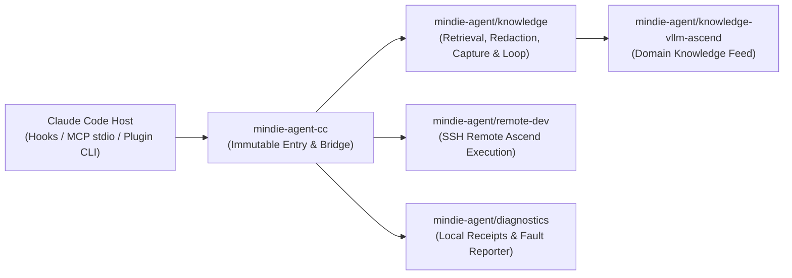

<p align="center">
  
</p>

<h1 align="center">MindIE Agent for Claude Code</h1>

<p align="center">
  <a href="https://github.com/mindie-agent/mindie-agent-cc/releases"></a>
  <a href="harness-compatibility.json"></a>
  <a href="pyproject.toml"></a>
  <a href="LICENSE"></a>
</p>

<p align="center">
  <a href="README.md">中文</a> | English
</p>

**MindIE Agent for Claude Code** (`mindie-agent-cc`) is the native Claude Code plugin adapter for [MindIE Agent](https://github.com/mindie-agent/mindie-agent), providing Ascend inference engineering workflows with on-demand domain knowledge retrieval, a local experience loop with privacy-gated community sharing, SSH remote Ascend development, and structured fault diagnostics.

This repository inherits all nine [MindIE Agent design principles](https://github.com/mindie-agent/mindie-agent/blob/main/docs/design-principles.md). Claude Code owns native plugin installation, updates, and removal records; this repository owns native task identity, hooks, public transcript parsing, and a fixed Python 3.13 runtime for each installed release; shared knowledge, publication, remote development, and fault diagnostics live in independent packages.

---

## Key Features

- **On-Demand Domain Knowledge Retrieval (`mindie-knowledge`)**: Query verified Ascend inference engineering knowledge (such as `vllm-ascend`) through native MCP tools. Knowledge is optional reference material that retains applicability conditions, evidence, and uncertainty; ordinary tasks never require mandatory queries, writes, or voting workflows.
- **Local Experience Loop & Privacy-Gated Community Sharing**:
  - Only when explicitly enabled by the user (opt-in) for a public repository and approved project root, native `Stop` events automatically associate the current task's public transcript projection followed by local deterministic redaction. Complete user and visible assistant messages are saved without tool payloads or a body-writing model.
  - Setup and updates automatically install the scanner and isolated block-index worker (using the selected native Claude model profile to produce bounded navigation metadata, never a replacement body; failed or uncertain indexing attempts remain visible with their execution and usage receipts, without silent retries or excerpt substitution).
  - Read the **[User & Contribution Notice](skills/mindie-agent/references/user-notice.md)** for sharing scope, redaction limits, model-provider processing, and public Git history. After presenting the user notice during setup, see **[Workspace Setup](skills/mindie-agent/references/workspace-setup.md)** for optionally creating and initializing [mindie-agent/vllm-ascend-workspace](https://github.com/mindie-agent/vllm-ascend-workspace.git) (both creation and initialization are optional and reuse existing user choices).
- **SSH Remote Ascend Development (`remote-dev`)**: Execute builds, tests, and debugging workflows on remote Ascend servers via the independent `remote-dev` MCP server. Remote development operates independently of knowledge service availability and contribution authorization.
- **Structured Fault Diagnostics & Optional Reporting (`mindie-diagnostics`)**: Errors remain visible to the caller, explicitly distinguishing completed work, failures, and uncertain external effects without silent fallbacks. Supports an independent opt-in choice for sanitized product fault reporting containing only static product stages, error types, and installed code versions.

---

## Quick Start

### 1. Prerequisites

Install `uv`, `git`, and an authenticated Claude Code with native plugin support (`CLAUDE_PLUGIN_DATA` is required for the persistent release entry):

- **Supported Claude Code Versions**: Release `0.0.1` (`v0.0.1`) declares support for exact tested versions `2.1.269` and `2.1.299` (see [`harness-compatibility.json`](harness-compatibility.json)), not every version between them.
- **Windows**: Git for Windows supplies the SSH implementation used by remote operations. Existing SSH and model settings are preserved.
- **Linux & WSL**: Inside WSL, use Linux-native Claude, Git, and `uv`, keeping the profile, SQLite state, and runtime on the Linux filesystem. On Linux and WSL, service-backed knowledge reads and automatic capture/indexing require a reachable `systemd` user manager (`systemd >= 254`, check via `systemctl --user show --property=Version`) and a unified cgroup hierarchy. A missing manager, unsupported version, or unverified containment is reported as an explicit service error with no unprotected fallback. Independent `remote-dev` operations do not use the knowledge service.

### 2. One-Line Install & Initialization (Release `v0.0.1`)

Confirm that release `v0.0.1` is available in [GitHub Releases](https://github.com/mindie-agent/mindie-agent-cc/releases), then run the following commands in a macOS/Linux/WSL shell or native Windows PowerShell using the same Claude profile throughout:

```sh
git --version
uv --version
claude --version
claude plugin marketplace add "https://github.com/mindie-agent/mindie-agent-cc.git#v0.0.1"
claude plugin install mindie-agent@mindie-agent-cc --scope user
claude --init-only
claude plugin list --json
claude mcp list
```

**Verification notes**:
1. `claude --init-only` completes installation through `SessionStart` and exits without starting a conversation or calling a model. It prepares Python 3.13 through `uv` and installs the complete `uv.lock` with `uv sync --locked --no-editable` (cold installation requires network access to declared dependencies).
2. Confirm `claude plugin list --json` reports `mindie-agent@mindie-agent-cc`, version `0.0.1`, enabled with `user` scope in the target profile.
3. Confirm `claude mcp list` shows both MindIE MCP servers (`mindie-knowledge` and `remote-dev`) as `Connected`. Running `--init-only` first ensures cold dependency installation finishes before ordinary MCP connection timeouts.

### 3. Optional Initialization & Slash Commands

Ordinary tasks do **not** need a per-task activation command—knowledge reads and `remote-dev` work on demand. Use the following slash commands when inspecting status or updating preferences:

| Command | Description |
|---|---|
| `/mindie-agent` or `/mindie-agent:init` | Optional configuration and status entry. Saved choices persist across sessions, forks, restarts, upgrades, and failures without re-prompting. |
| `/mindie-agent:status` | Read-only status reporting existing knowledge configuration, service/storage health, bound task state, failure counters, and the latest 5 captures and contribution batches. |
| `/mindie-agent contribute --repository owner/repo --account USER --project-root /absolute/path --visibility public` | Explicitly configure opt-in public knowledge contribution (no default consent; repository, account, project root, and public visibility must be specified together). |
| `/mindie-agent:sharing-enable` / `/mindie-agent:sharing-disable` | Enable or stop knowledge contribution for the configured scope (with contribution off, `Stop` performs no transcript collection, capture, or organizer call). |
| `/mindie-agent:deactivate` | End the current task's knowledge access without uninstalling the plugin. |
| `/mindie-agent:recover` | Inspect failed batch IDs or trigger recovery (unknown publication effects must be reconciled before any explicit retry). |
| `/mindie-agent:reporting-status` | Read the independent product failure reporting setting and reporter readiness. |
| `/mindie-agent:reporting-enable` / `/mindie-agent:reporting-disable` | Enable or revoke sanitized product fault reporting to `mindie-agent/mindie-agent` (`reporting-enable` returns a one-time preparation command to run outside the hook; verify both runtime ready and worker healthy). |

### 4. Updates & Uninstall

- **Silent Compatible Updates**: After more than 24 hours since a successful Release check, the next natural MCP tool call starts one asynchronous check (ordinary calls perform an in-process timestamp comparison only). The shared Release selector chooses the highest compatible official Release declared in [`harness-compatibility.json`](harness-compatibility.json), builds the immutable `uv` runtime outside operation admission, and switches atomically when Core admission is free (the 30-second observation window is a control bound and never kills active work).
- **Safe Uninstall**: Close tasks using the plugin, then run Claude's native uninstall command under the same profile while retaining data:

```sh
claude plugin uninstall mindie-agent@mindie-agent-cc --scope user --keep-data --json
```

> **Note**: Keep runtime data, receipts, and retained launchers while existing tasks may still use them. Uninstalling this adapter does not disable the shared fault reporter across other adapters; run `/mindie-agent:reporting-disable` separately if desired.

---

## Architecture & Component Map

`mindie-agent-cc` maintains a strict thin-adapter boundary without duplicating the knowledge engine or introducing a second state store:



| Repository / Component | Responsibility |
|---|---|
| [`mindie-agent/mindie-agent`](https://github.com/mindie-agent/mindie-agent) | Architecture, nine design principles, domain boundaries, and paired-release governance. |
| `mindie-agent/mindie-agent-cc` (this repo) | Claude Code native plugin manifest (`.claude-plugin/`, `.mcp.json`, `hooks/`, `skills/`), task identity bridge, public transcript parser, and immutable runtime lifecycle (`scripts/`). |
| [`mindie-agent/knowledge`](https://github.com/mindie-agent/knowledge) | Shared knowledge core: local SQLite/FTS retrieval, deterministic redaction, capture queue, block-index scheduling, PR publication receipts, and release compatibility validation. |
| [`mindie-agent/knowledge-vllm-ascend`](https://github.com/mindie-agent/knowledge-vllm-ascend) | Curated `vllm-ascend` domain knowledge feed (pinned by contract SHA-256 and verified commit in [`product-contract.json`](product-contract.json)). |
| [`mindie-agent/remote-dev`](https://github.com/mindie-agent/remote-dev) | Bounded remote command execution, workspace synchronization, and long-job polling over SSH for Ascend servers. |
| [`mindie-agent/diagnostics`](https://github.com/mindie-agent/diagnostics) | Bounded local diagnostic retention and optional sanitized GitHub Issue fault reporting. |

### Local Storage Layout

- **Immutable Runtime Directories**: `${XDG_DATA_HOME:-$HOME/.local/share}/mindie-agent/runtimes/cc` on macOS/Linux/WSL, or `%LOCALAPPDATA%/mindie-agent/runtimes/cc` on Windows (keyed by package source, lock, Python ABI, and platform; damage is reported rather than repaired in place).
- **Persistent Release Entry**: `CLAUDE_PLUGIN_DATA/releases/0.0.1/entry.py` (binds one exact installed facade and profile; hot hooks run `uv` offline with Python downloads disabled).
- **Shared Business Configuration**: `${XDG_CONFIG_HOME:-$HOME/.config}/mindie-agent/cc.json` (records the installation binding; contribution scope and user consent remain separate persistent user data).

---

## Reproducible Component Verification

Run the locked component test suite from the repository root (requires a local checkout of `mindie-agent/knowledge` at the exact commit declared in [`uv.lock`](uv.lock)):

```sh
uv sync --locked --no-editable --group test
MINDIE_TEST_KIMI_SCRIPTS="$PWD/tests/fixtures/kimi-86de2c3/scripts" \
MINDIE_TEST_KNOWLEDGE_CHECKOUT=/absolute/path/to/declared-knowledge-checkout \
uv run --locked --no-editable --group test python -m pytest -q
```

Verify the product contract and Harness interface registry:

```sh
uv run --locked --no-editable --group test python scripts/product_contract.py --source .
uv run --locked --no-editable --group test python scripts/harness.py --source . --tests tests --revision "$(git rev-parse HEAD)"
```

---

## Documentation Index

Detailed architecture and contract documentation is available in [`docs/`](docs/README.en.md) in both Chinese and English:

- **[Documentation Index (English)](docs/README.en.md)** | **[文档索引（中文）](docs/README.md)**
- **Claude Code Native Boundary**: [English](docs/native-boundary.md) | [中文](docs/native-boundary.zh.md) — Task identity binding, `PreToolUse`/`Stop` hook behavior, and shared runtime division of responsibilities.
- **Harness Interface Evidence & Fork Attribution**: [English](docs/harness-interface-evidence.md) | [中文](docs/harness-interface-evidence.zh.md) — Declared Claude Code interface support, structured-output retry boundaries, and `--fork-session` attribution.
- **Fixed-Runtime Service Continuity**: [English](docs/service-continuity.md) | [中文](docs/service-continuity.zh.md) — Immutable `uv` runtime preparation, shared/exclusive admission control, seamless owner handoff, and `Stop` queue durability.
- **Failure Diagnosis & Local Cancellation**: [English](docs/failure-diagnostics.md) | [中文](docs/failure-diagnostics.zh.md) — Read-only status semantics, local process cancellation bounds, native failure projection, and automatic product fault reports.
- **Framework Stability & Verification Boundaries**: [English](docs/framework-stability.md) | [中文](docs/framework-stability.zh.md) — Everyday usage invariants, Windows atomic configuration reads/writes, and reproducible test contracts.

---

## License

Released under the [MIT License](LICENSE).
