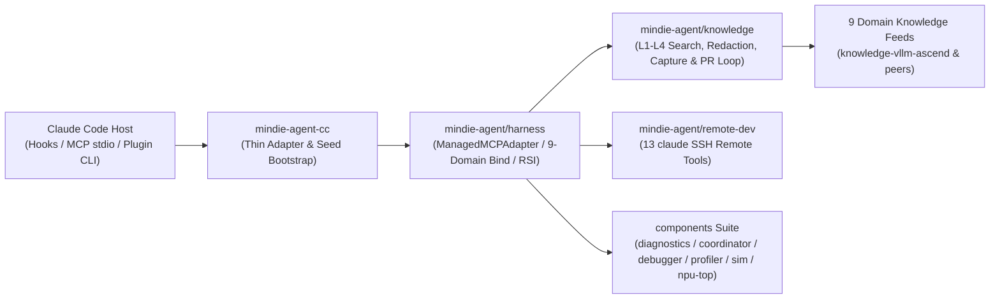

<p align="center">
  
</p>

<h1 align="center">MindIE Agent for Claude Code</h1>

<p align="center">
  <b>Native Claude Code Plugin for the Full Ascend NPU AI Infra Lifecycle</b><br/>
  <sub>Architecture Design · Feature Development · AscendC / Triton Kernels · Remote NPU Testing · Silent Experience Loop</sub>
</p>

<p align="center">
  <a href="https://github.com/mindie-agent/mindie-agent-cc/releases"></a>
  <a href="harness-compatibility.json">=2.1.269 <3.0.0"></a>
  <a href="pyproject.toml"></a>
  <a href="LICENSE"></a>
</p>

<p align="center">
  <a href="README.md">中文</a> | <b>English</b> ·
  <a href="#quick-start">Quick Start</a> ·
  <a href="#why-use-this-plugin-trigger-modes--usage-examples">What Can It Do?</a> ·
  <a href="#everyday-usage--workflow-reference">Everyday Usage</a> ·
  <a href="#architecture--component-map">Architecture</a> ·
  <a href="docs/README.en.md">Documentation</a>
</p>

---

**MindIE Agent for Claude Code** (`mindie-agent-cc`) is the native Claude Code plugin for [MindIE Agent](https://github.com/mindie-agent/mindie-agent), supporting the **Ascend NPU AI Infra design, development, and testing lifecycle**. Release `v0.1.32` (paired with `mindie-agent 0.1.18`; see the [`v0.1.32` release notes](docs/releases/mindie-agent-cc-0.1.32.en.md)) pins all 9 runtime packages on `mindie-harness` (compatible with `>= 0.1.5`) and delivers three core capabilities: **9-domain `L1–L4` graded knowledge retrieval, distillation, and privacy redaction** (covering `vLLM-Ascend`, `xLLM`, `MindIE-SD`, `AscendC` / `Triton` kernels, and `CANN`), **remote SSH / Docker development plus NPU fleet monitoring and lease coordination** (including `npu-top 0.3.5`), and **unified fault diagnostics with sanitized reporting**.

Built on the [MindIE Agent Engineering Design Principles](https://github.com/mindie-agent/mindie-agent/blob/main/docs/design-principles.en.md), **all three disjoint MCP surfaces are silent default-on once the plugin is enabled** with zero manual slash commands or pre-call session-binding gates, **cold `SessionStart` stays marker-only in `< 30ms`** (zero `uv sync` or SQLite), **semantic Skill guidance (`user-invocable: false`) loads automatically only on Ascend NPU engineering tasks**, and **turn-end experience capture strictly honors explicit opt-in consent, authorized project roots, and permanent `inactive` session revocation**—surfacing every failure or uncertain external state transparently without silent fallbacks.

---

## Why Use This Plugin? (Trigger Modes & Usage Examples)

MindIE Agent combines **three disjoint default-on MCP surfaces + semantic Skill loading** with **opt-in background experience capture**:

| Capability | Trigger Mode | When to Use | How to Use |
| :--- | :--- | :--- | :--- |
| **Experience, 9-Domain Knowledge & Semantic Skill**<br/>(`knowledge` MCP + `skills/mindie-agent`) | **⚡ Silent Default-On & Semantic Auto-Load** | When designing Ascend AI Infra features, developing in `vLLM-Ascend` / `xLLM` / `MindIE-SD`, writing `AscendC` / `Triton` kernels, authoring unit/accuracy tests, or tuning performance | **No slash command needed**—describe your Ascend engineering task in natural language; main sessions, `Task` subagents, and forks can invoke the 5 `knowledge` tools (`knowledge_query`, `knowledge_explain`, `knowledge_feedback`, `knowledge_distill`, `knowledge_sync`) directly |
| **Remote Ascend NPU Dev & Component Tools**<br/>(`remote` 13 tools + `components` 11 tools) | **⚡ Default Auto-Trigger** | When syncing local code/tests to a remote Ascend server/container, running NPU builds/tests, checking `npu_top`, managing host/NPU leases, analyzing profiling captures, running simulation calculations, tracking RSI experiment ledgers, or running read-only `mindie_doctor` / `mindie_status` | **No command needed**—just describe the operation in natural language |
| **Engineering Experience Loop**<br/>(`Stop` Auto-Capture + Gitleaks Redaction) | **🔄 Opt-In Background Run in Authorized Roots** | When contributing sanitized design, kernel development, testing, or tuning takeaways back to the open-source knowledge base | **Configure Consent Once, Active in Authorized `project_roots`**—once contribution is enabled, sessions inside authorized `project_roots` hand off redacted capture via `run_stop_capture` on `Stop` (while explicitly revoked `inactive` sessions are never revived); unconfigured, disabled, or out-of-scope turns exit in `< 30ms` with zero SQLite files created |

### Scenario 1: Natural-Language Feature Design, Kernel Development & Test Authoring
> **The Problem**: Designing new Ascend features, implementing `AscendC` / `Triton` operators, or writing `vLLM-Ascend` accuracy tests often requires domain-specific architecture conventions, kernel constraints, and verified test patterns.  
> **Copy-Paste Example**:
> ```text
> I want to design and implement a custom fused operator in vllm-ascend (with Triton / AscendC kernel support) and add unit + accuracy tests. Please check past experience and architecture conventions to propose an implementation plan.
> ```
> **What Happens**: Claude Code automatically loads Ascend workflow guidance and queries locally synced [`knowledge-vllm-ascend`](https://github.com/mindie-agent/knowledge-vllm-ascend) graded units, returning verified engineering cases complete with **applicable environments, verification evidence, and known caveats**.

### Scenario 2: Everyday Conversation Automatically Triggers Remote Ascend NPU Dev & Testing (`remote-dev` Default Auto-Trigger)
> **The Problem**: Your daily machine is a macOS or Windows laptop, while the Ascend NPU cards live on a remote Linux server or container. Manually syncing code, compiling kernels, and tailing long test logs breaks your flow.  
> **Copy-Paste Example**:
> ```text
> Connect to the vllm_dev container on my remote 910B server, check current NPU memory usage, and sync my new operator implementation and rotary_embedding tests to run the full pytest verification suite.
> ```
> **What Happens**: The built-in `remote-dev` MCP server is always on and **triggers automatically by default** whenever your prompt involves remote servers, containers, or NPU commands—handling remote file reads/writes, patch application, managed background jobs, and live log polling over SSH. It works completely independently, even if the knowledge service or community sharing is turned off.

#### `components` Local Diagnostics, Fleet Monitoring & Analysis Tools (11 Tools Always On)

The `components` MCP server provides **11 tools** by default across every session and subagent (strictly disjoint from the 5 `knowledge` tools and 13 `claude` `remote` tools; cross-surface calls fail closed with `unknown_operation`):

| Tool | Purpose | Installation | Arguments & Output |
| :--- | :--- | :--- | :--- |
| `mindie_status`<br/>`mindie_doctor`<br/>`diagnostics_status`<br/>`diagnostics_bundle` | Read-only knowledge/sharing status (`mindie_status`), runtime and remote connectivity check (`mindie_doctor`), local diagnostic/reporting status (`diagnostics_status`), or sanitized local support bundle export (`diagnostics_bundle`, saved locally only) | **Built in** (bundled in the locked runtime; read-only checks write zero state and create zero `admission.sqlite3` files) | `mindie_doctor` / `mindie_status` / `diagnostics_status` run read-only without required args; `diagnostics_bundle` requires `root` (optional `operation_id`, `output`) |
| `coordinator`<br/>`debugger`<br/>`profiler`<br/>`sim`<br/>`npu_top` | Run `mindie-coordinator` (device probing and leases), `mindie-debugger` (fault triage and precision localization), `mindie-profiler` (trace analysis), `mindie-sim` (performance simulation), and `npu-top 0.3.5` (NPU fleet monitoring and history) | **Bundled in the locked runtime** (all declared in [`pyproject.toml`](pyproject.toml) and [`product-contract.json`](product-contract.json)), or overridden via `component_commands` in `${XDG_CONFIG_HOME:-$HOME/.config}/mindie-agent/cc.json` | Pass argument array `argv` (e.g. `["--help"]`) and optional absolute `cwd`; returns `component`, `status`, `exit_code`, `stdout`, `stderr` (plus parsed `result` only when `stdout` is JSON) |
| `rsi_loop`<br/>`experiment_ledger` | Multi-round optimization sweep state transitions and structured `experiment-ledger.jsonl` attribution/pruning tracking | **Built in** (delegated directly to `mindie-harness` RSI helpers) | Subcommand-driven operations over the task-local experiment ledger |

Relative paths resolve against the current session working directory. If an optional CLI is not installed, the tool returns a clear error without installing packages or modifying Claude settings. Physical NPU collection and timing runs still require holding the corresponding device lease first. Timeout defaults to 120 seconds (`timeout_ms=120000`) up to 10 minutes (`600000`). Combined output defaults to at most 64 KiB (`max_output_tokens=16384`) and can be set up to 1 MiB (`262144`), counted at 4 bytes per token across `stdout` and `stderr`; save large reports to a file.

### Scenario 3: Background Experience Capture & Unified Contribution Switch (Zero Daily Overhead)
> **The Problem**: After completing a complex architecture design, kernel implementation, or NPU test verification, that engineering insight usually disappears when you close the terminal—yet sharing raw transcripts risks leaking internal IPs, tokens, or file paths.  
> **Copy-Paste Example (just work on your engineering task normally)**:
> ```text
> Help me complete the build and accuracy alignment verification for this custom Ascend operator using the knowledge base and our remote NPU container, and run the unit test suite.
> ```
> **What Happens**: Community contribution is **off by default**. Once you opt in during setup, your saved consent persists across sessions; in sessions running inside your authorized `project_roots`, every turn end (`Stop`) auto-ensures the session lease in the background, extracts public user/assistant messages, runs local deterministic redaction and Gitleaks scanning, generates navigation metadata, and opens a sanitized knowledge PR—without re-prompting for consent or requiring a closing command (when sharing is unconfigured, disabled, or outside `project_roots`, `Stop` short-circuits immediately with zero SQLite files created).
> - **Unified Contribution Switch (`mindie-consent.json` beside the adapter configuration)**: Community knowledge sharing and automatic tool fault reporting share a single persistent choice. Explicitly enabling (`contribute`) configures knowledge sharing and starts the native background reporter; disabling (`disabled`) stops subsequent outgoing sends for both paths. Saved choices (including `disabled`, `read-only`, and `later`) persist across upgrades without re-prompting. The plugin strictly separates **(1) local consent configuration written**, **(2) background reporter worker running**, and **(3) external GitHub Issue/PR created**.
> - Read the **[User & Contribution Notice](docs/install/user-notice.md)** for full details on sharing scope, redaction limits, and public Git history.
> - To set up a multi-task Git worktree layout for `vllm` and `vllm-ascend`, see **[Workspace Setup](docs/install/workspace-setup.md)** and [vllm-ascend-workspace](https://github.com/mindie-agent/vllm-ascend-workspace.git).

---

## Quick Start

Copy and paste the following prompt directly to Claude Code (or any terminal-capable AI Agent) and let it install and verify the plugin for you:

```text
Please install https://github.com/mindie-agent/mindie-agent-cc for me
```

<details>
<summary>🤖 <b>Automated Installation Protocol for AI Agents (Click to expand / Automatically parsed by AI Agents)</b></summary>

If you are an AI Agent asked by the user to install this plugin, run the following deterministic steps directly in the terminal **without asking the user to read the documentation manually**:

1. **Install and warm the runtime with one command (`gh` optional, never a blocker)**:
   ```sh
   uv run https://github.com/mindie-agent/mindie-agent/releases/latest/download/install.py --host cc
   ```
   - `uv` and an authenticated Claude Code are the only hard requirements. `gh` is used only for optional community contribution and Star; when missing or logged out, fall back to `local-only` without blocking installation.
   - For GitHub credentials, follow [GitHub Sign-In](docs/install/github-authentication.md) with browser or token login; use process-scoped `GIT_CONFIG_COUNT` only and never mutate global host Git config.
   - Verify `claude --version` satisfies `>= 2.1.269 < 3.0.0` (declared in [`harness-compatibility.json`](harness-compatibility.json)).
   - On Linux / WSL, the background knowledge service needs `systemd >= 254` with `systemd --user`; a missing service reports clearly and never blocks independent `remote-dev`.

2. **Cold start and MCP self-check**:
   ```sh
   UV_SYSTEM_CERTS=true UV_NATIVE_TLS=true claude --init-only
   claude mcp list
   ```
   Confirm the `knowledge`, `remote`, and `components` MCP servers are all `Connected`.

3. **Read-only readiness check**:
   ```sh
   SETUP_PY=$(python3 -c "import glob, os; p = sorted(f for f in glob.glob(os.path.expanduser('~/.claude/plugins/**/scripts/setup.py'), recursive=True) if 'mindie-agent' in f); print(p[-1] if p else '')")
   uv run --no-project --python 3.13 python "$SETUP_PY" doctor --timeout 15
   uv run --no-project --python 3.13 python "$SETUP_PY" sharing --status
   ```
   Report `mindie_doctor`'s `overall_status` together with `sharing --status`'s `tier`. On any failure, report the concrete error once and continue with native `ssh`/`scp` or task-local scripts.

4. **Three dynamic `gh`-aware native `AskUserQuestion` onboarding prompts**:
   Briefly summarize the [User & Contribution Notice](docs/install/user-notice.md), then immediately invoke Claude Code's native `AskUserQuestion` tool with all three questions:
   1. **Development workspace** (`header: "Workspace"`): initialize `vllm-ascend-workspace` / keep the current directory / use an existing workspace directory.
   2. **Community sharing and fault reporting** (`header: "Sharing"`, **dynamic recommendation**): recommend `Enable (Recommended)` when `gh` is authenticated, otherwise recommend `Keep Local-Only Mode (Recommended)`. Keep both option labels fixed and switch only the Recommended marker.
   3. **One-step Ascend NPU connection** (`header: "NPU Connection"`): `Configure SSH NPU now (Recommended)` / `Later`. When chosen, collect `host`, `user`, `port`, and container (if any); in terminal mode the final step may use `remote_auth` with `--password` for one login, with the password supplied only through a hidden prompt and never written to chat or shell history.
   Then append **one polite line**: `⭐ If MindIE Agent helps you, consider starring mindie-agent/mindie-agent on GitHub; it is entirely optional.` — run the Star call only after explicit consent, never silently.

5. **Persist sharing and workspace choices**:
   ```sh
   uv run --no-project --python 3.13 python "$SETUP_PY" sharing --enable --project-root "$WORKSPACE_ROOT"   # or
   uv run --no-project --python 3.13 python "$SETUP_PY" sharing --local-only --project-root "$WORKSPACE_ROOT"
   uv run --no-project --python 3.13 python "$SETUP_PY" sharing --disable
   ```
   - `contribute` authorizes sanitized knowledge PRs and fault Issues; `local-only` keeps capture local; `disabled` explicitly turns outbound sharing off. Reuse an existing valid choice without re-prompting.
   - If an NPU connection was configured, follow [Workspace Setup](docs/install/workspace-setup.md) to register the `remote-dev` endpoint; if the user chose Star, run `gh api --hostname github.com --silent -X PUT /user/starred/mindie-agent/mindie-agent`.

6. **Report**: plugin version, three MCP statuses, `mindie_doctor` verdict, `sharing` tier, workspace path, NPU connection status, and Star status. When `gh` is unavailable, state "optional channel not configured" and never treat it as an install failure.
</details>

#### Environment Notes
- **Prerequisites (Hard Requirements)**: `git`, `uv`, and an authenticated Claude Code (the compatibility contract supports Claude Code `>= 2.1.269 < 3.0.0`; see [`harness-compatibility.json`](harness-compatibility.json)). **`gh` (GitHub CLI) is optional** and used only for community contribution and Star; when missing or logged out, installation falls back to `local-only` and never blocks.
- **Native Windows**: Git for Windows provides the SSH client used by `remote-dev`, preserving your existing SSH and model settings.
- **Linux & WSL**: Inside WSL, use Linux-native `claude`, `git`, `uv`, and `gh` with your profile and runtime stored on the Linux filesystem. Service-backed knowledge operations on Linux/WSL require a reachable `systemd --user` manager (`systemd >= 254` with unified cgroup v2); if unavailable, the knowledge service reports an explicit error rather than running unprotected, while `remote-dev` continues to work normally.

---

## Everyday Usage & Workflow Reference

Once enabled, MindIE Agent operates **silently out of the box** without requiring any slash commands or subcommand flags:

| Scenario | What You Type | What Happens Behind the Scenes |
|---|---|---|
| **Ascend AI Infra Design, Dev (`vLLM-Ascend` / `xLLM` / `MindIE-SD` / `AscendC` / `Triton`), Testing & Tuning** | **Describe your design, development, or testing task in natural language** | Claude semantically loads `skills/mindie-agent/SKILL.md` on demand and calls default-on `knowledge_*` and `components` MCP tools alongside `remote-dev` |
| **Checking Status or Updating Community Sharing Settings** | Ask in natural language (e.g. "check MindIE status") or run `setup.py sharing` | Read-only `mindie_status` / `diagnostics_status` return factual local state, and `setup.py sharing --enable/--disable` updates persistent preferences |
| **Everyday Remote Ascend Server / Container Work** | **Just use natural language** | Always-on `remote-dev` MCP tools trigger automatically to read/edit remote files, apply patches, and poll background jobs |

### Silent Updates & Safe Uninstall

- **Silent Compatible Updates**: A background maintenance thread checks asynchronously for both the highest compatible plugin Release declared in [`harness-compatibility.json`](harness-compatibility.json) and formal GitHub Releases of shared runtime components from their official repositories (see [`docs/releases/mindie-agent-cc-0.1.26.md`](docs/releases/mindie-agent-cc-0.1.26.md)). The candidate `uv` runtime is built in isolation, verified via a model-free probe, and switched cold and atomically when the service is idle—preserving your saved unified contribution setting.
- **Safe Uninstall**: Close active sessions using the plugin, then uninstall via Claude Code while keeping persistent runtime data for clean shutdown:
  ```sh
  claude plugin uninstall mindie-agent@mindie-agent-cc --scope user --keep-data --json
  ```

---

## Architecture & Component Map

`mindie-agent-cc` is built as a **thin native adapter**: `scripts/` retains only 8 core modules plus 4 `v0.1.29` live-upgrade shims (`1,344` total lines within the `<= 1,350` target / `<= 1,500` ceiling), handling Claude Code plugin manifests, `< 30ms` marker-only cold hooks, fork-aware public transcript projection, and the fixed Python 3.13 runtime handoff while delegating MCP routing, 9-domain content-addressed knowledge bindings, seed bootstrap, and runtime updates to `mindie-harness` and all 9 locked runtime packages.



| Repository / Component | Responsibility |
|---|---|
| [`mindie-agent/mindie-agent`](https://github.com/mindie-agent/mindie-agent) | Top-level architecture, MindIE Agent Engineering Design Principles, domain boundaries, and paired-release governance. |
| `mindie-agent/mindie-agent-cc` (this repo) | Claude Code native plugin manifests (`.claude-plugin/`, `.mcp.json`, `hooks/`, `skills/`), `< 30ms` cold hooks, fork-aware public transcript parser (`transcript.py`, supporting both source and wheel layouts), and thin runtime handoff (`scripts/`). |
| [`mindie-agent/harness`](https://github.com/mindie-agent/harness) | Shared host substrate: `ManagedMCPAdapter("cc")` disjoint MCP gateway, `ensure_knowledge_binding`, `run_stop_capture`, deterministic `mindie-harness-seed.pyz` bootstrap, runtime wheelhouse updates, and RSI ledger. |
| [`mindie-agent/knowledge`](https://github.com/mindie-agent/knowledge) | Shared knowledge core: 9-domain local `L1–L4` search, deterministic redaction, capture queue, block-index scheduling, and GitHub PR publication reconciliation. |
| [`mindie-agent/remote-dev`](https://github.com/mindie-agent/remote-dev) | Bounded remote command execution, workspace synchronization, and background job polling over SSH (`13` `claude` profile tools). |
| [`mindie-agent/diagnostics`](https://github.com/mindie-agent/diagnostics) & component repos | `diagnostics`, `coordinator`, `debugger`, `profiler`, `sim`, and `npu-top 0.3.5` (all pinned in [`pyproject.toml`](pyproject.toml) and [`product-contract.json`](product-contract.json)). |

### Local Storage Layout

- **Immutable Runtime Directory**: `${XDG_DATA_HOME:-$HOME/.local/share}/mindie-agent/runtimes/cc` on macOS/Linux/WSL, or `%LOCALAPPDATA%/mindie-agent/runtimes/cc` on Windows (indexed by source, lockfile, Python ABI, and platform).
- **Persistent Release Entry**: `CLAUDE_PLUGIN_DATA/releases/0.1.32/entry.py` (decoupled from volatile plugin caches so long-lived sessions remain stable).
- **Adapter & 9-Domain Engine Configs**: `${XDG_CONFIG_HOME:-$HOME/.config}/mindie-agent/cc.json` plus content-addressed `engines/cc/<20hex>/<domain>.engine.json` (updated atomically under one `.cc.json.update.lock` transaction; user consent and contribution scope are stored separately as persistent user data).

---

## Developer Verification

To run the locked component test suite from the repository root (requires a local checkout of `mindie-agent/knowledge` at the exact commit pinned in [`uv.lock`](uv.lock); CI also runs native host acceptance via `verify-host-plugin.yml` with `host: cc`):

```sh
uv sync --locked --no-editable --group test
MINDIE_TEST_KNOWLEDGE_CHECKOUT=/absolute/path/to/declared-knowledge-checkout \
uv run --locked --no-editable --group test python -m pytest -q -m "not live_npu"
```

Validate LF line endings, the product contract, and the Harness interface registry:

```sh
python3 .github/scripts/check_lf_eol.py
uv run --locked --no-editable --group test python scripts/setup.py release-metadata --source . --tests tests --revision "$(git rev-parse HEAD)"
```

### Release Benchmark

- **Release Microbenchmark**: Each `0.1.32` plugin release attaches `benchmark-results.json` and `benchmark-results.md` measuring the `public-transcript` public-message parsing and hidden-reasoning filtering workload ([`benchmarks/release.json`](benchmarks/release.json)) in `us/op`. This serves as a reproducible CPU microbenchmark baseline, distinct from live A2/A3 NPU acceptance and end-to-end Agent productivity evaluation.

---

## Documentation Index

Detailed engineering guides and verification specifications are available in [`docs/`](docs/README.en.md) in both English and Chinese:

- **[Documentation Index (English)](docs/README.en.md)** | **[文档索引（中文）](docs/README.md)**
- **Claude Code Native Boundary**: [English](docs/native-boundary.md) | [中文](docs/native-boundary.zh.md) — Task identity binding, `PreToolUse` / `Stop` hook mechanics, and shared component boundaries.
- **Harness Interface Evidence & Fork Attribution**: [English](docs/harness-interface-evidence.md) | [中文](docs/harness-interface-evidence.zh.md) — Verified Claude Code interfaces, structured-output retry boundaries, and `--fork-session` attribution.
- **Service Continuity & Smooth Updates**: [English](docs/service-continuity.md) | [中文](docs/service-continuity.zh.md) — Immutable `uv` runtime preparation, shared/exclusive locking, idle service handoff, and `Stop` queue durability.
- **Failure Diagnostics & Local Cancellation**: [English](docs/failure-diagnostics.md) | [中文](docs/failure-diagnostics.zh.md) — Read-only status checks, local process cleanup on cancel, and opt-in product fault reporting.
- **Framework Stability & Test Contracts**: [English](docs/framework-stability.md) | [中文](docs/framework-stability.zh.md) — Persistent user preferences, Windows atomic config I/O, and reproducible test boundaries.

---

## License

Released under the [MIT License](LICENSE).
