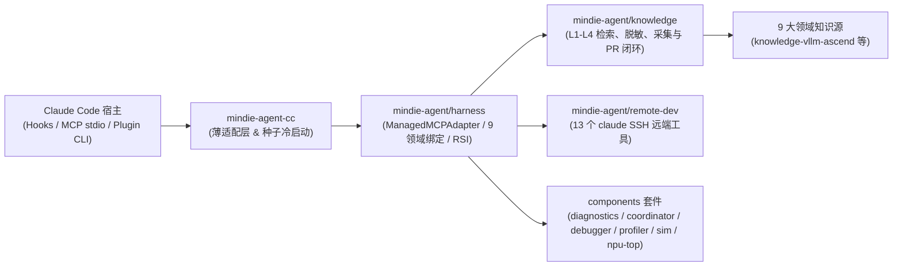

<p align="center">
  
</p>

<h1 align="center">MindIE Agent for Claude Code</h1>

<p align="center">
  <b>面向昇腾（Ascend）NPU AI Infra 研发、设计与测试全流程的 Claude Code 原生插件</b><br/>
  <sub>覆盖架构设计 · 特性开发 · AscendC / Triton 算子实现 · 远端 NPU 测试验证 · 研发经验静默沉淀</sub>
</p>

<p align="center">
  <a href="https://github.com/mindie-agent/mindie-agent-cc/releases"></a>
  <a href="harness-compatibility.json">=2.1.269 <3.0.0"></a>
  <a href="pyproject.toml"></a>
  <a href="LICENSE"></a>
</p>

<p align="center">
  <b>中文</b> | <a href="README.en.md">English</a> ·
  <a href="#快速开始">快速开始</a> ·
  <a href="#装上之后能做什么触发方式与使用示例">应用场景</a> ·
  <a href="#日常使用与工作流参考">日常使用</a> ·
  <a href="#架构与组件边界">系统架构</a> ·
  <a href="docs/README.md">技术文档</a>
</p>

---

**MindIE Agent for Claude Code**（`mindie-agent-cc`）是 [MindIE Agent](https://github.com/mindie-agent/mindie-agent) 面向 Claude Code 的原生插件，服务于**昇腾（Ascend）NPU 上的 AI Infra 设计、开发与测试全流程**。当前 `v0.1.32`（配套主产品 `0.1.18`，详情见 [`v0.1.32` 发布说明](docs/releases/mindie-agent-cc-0.1.32.md)）基于 `mindie-harness`（兼容 `>= 0.1.5`）锁定全部 9 大运行时包，交付三大核心能力：**9 领域 `L1–L4` 分级知识库检索、蒸馏与隐私脱敏**（覆盖 `vLLM-Ascend`、`xLLM`、`MindIE-SD`、`AscendC` / `Triton` 算子与 `CANN` 工程）、**远端 SSH / Docker 开发与 NPU 集群监控/租约协调**（含 `npu-top 0.3.5`），以及**统一故障诊断与脱敏上报**。

项目设计遵循 [MindIE Agent 工程设计原则](https://github.com/mindie-agent/mindie-agent/blob/main/docs/design-principles.md)：**插件启用后三套正交 MCP 工具集静默默认就绪（Silent Default-On）**，无需输入任何斜杠命令或前置会话绑定；冷态 `SessionStart` 保持 `< 30ms` 纯标记写入（零 `uv sync`、零 SQLite）；语义 Skill（`user-invocable: false`）仅在涉及昇腾 NPU 研发任务时由 Claude 按需加载；社区经验采集严格遵循显式 Opt-In、授权目录边界与已撤权会话永久停用保护，所有状态与报错真实透明，不做静默降级或盲目重试。

---

## 装上之后能做什么？（触发方式与使用示例）

MindIE Agent 采用**「三套正交 MCP 工具默认就绪 + 昇腾语义 Skill 按需静默加载 + 社区经验显式授权后台沉淀」**的设计：

| 能力模块 | 触发方式 | 什么时候用？ | 怎么用？ |
| :--- | :--- | :--- | :--- |
| **经验、9 领域知识库与语义 Skill 系统**<br/>（`knowledge` MCP + `skills/mindie-agent`） | **⚡ 静默默认就绪 & 语义自动加载** | 开展昇腾 AI Infra 架构设计、`vLLM-Ascend` / `xLLM` / `MindIE-SD` 特性开发、`AscendC` / `Triton` 算子实现、单测/精度测试构建、性能调优或问题定位时 | **无需任何斜杠命令**，直接用自然语言描述昇腾研发任务即可；主会话、`Task` 子智能体与分支会话均可直接调用 `knowledge` 服务的 5 个工具（`knowledge_query`、`knowledge_explain`、`knowledge_feedback`、`knowledge_distill`、`knowledge_sync`） |
| **远端昇腾 NPU 开发与本地组件工具**<br/>（`remote` 13 工具 + `components` 11 工具） | **⚡ 默认自动触发** | 日常需要将本地代码同步到远端昇腾服务器/容器、跑编译与测试、查看 `npu_top` 看板、管理机器/NPU 租约、分析采集数据、做仿真测算、追踪 RSI 实验账本或执行只读 `mindie_doctor` / `mindie_status` 时 | **无需额外命令**，直接用自然语言描述操作即可 |
| **研发经验沉淀与社区共建**<br/>（`Stop` 后台采集 + Gitleaks 脱敏） | **🔄 显式开启且在授权目录内自动运行** | 希望将有价值的架构设计、算子开发、测试验证或调优经验脱敏沉淀回开源知识库时 | **授权一次配置，授权目录内无感生效**——开启社区贡献并绑定 `project_roots` 后，位于授权目录内的会话回合结束时经 `run_stop_capture` 完成本地脱敏与知识 PR 整理（显式停用的 `inactive` 会话永不被复活）；未开启或超出授权目录时在 `< 30ms` 内静默退出且零 SQLite 副作用 |

### 场景 1：自然语言直接唤醒知识库与语义 Skill 辅助设计、开发与测试
> **痛点**：在昇腾上设计新特性、开发 `AscendC` / `Triton` 算子或编写 `vLLM-Ascend` 测试时，缺少现成的架构规范、算子接口约束与历史经验参考。  
> **用法示例（直接复制发给 Claude Code）**：
> ```text
> 我准备在 vllm-ascend 中为新模型设计并接入一个自定义融合算子（支持 Triton / AscendC 实现）并补齐单元与精度测试，请结合知识库里的现有设计规范和开发经验帮我制定实现方案。
> ```
> **会发生什么**：Claude Code 自动按需加载昇腾研发工作流规范并检索本地同步的 [`knowledge-vllm-ascend`](https://github.com/mindie-agent/knowledge-vllm-ascend) 等分级知识库，返回带有**适用条件、验证证据和已知限制**的真实设计、开发与测试单元。

### 场景 2：日常对话直接操作远端昇腾 NPU 服务器与容器（`remote-dev` 默认自动触发）
> **痛点**：开发机是 Mac 或 Windows 笔记本，而昇腾 NPU 环境在远端服务器或容器里，频繁手动同步代码、编译算子、看长耗时测试日志非常繁琐。  
> **用法示例（直接用自然语言发给 Claude Code）**：
> ```text
> 帮我连上远端 910B 服务器的 vllm_dev 容器，看看当前 NPU 显存占用，然后把我本地新写的算子实现和 rotary_embedding 单测同步过去跑一下完整的 pytest 验证。
> ```
> **会发生什么**：内置的 `remote-dev` MCP 服务作为常驻工具集，会在识别到远端开发意图时**默认自动触发**，完成文件读写、补丁同步、长耗时编译/测试后台托管与实时日志轮询。即使不开启知识库服务或社区贡献，`remote-dev` 也能完全独立工作。

#### `components` 本地诊断、监控与分析组件工具（默认常驻 11 工具）

插件通过 `components` MCP 服务在所有会话与子智能体中默认提供以下 **11 个工具**（与 `knowledge` 的 5 个工具、`remote` 的 13 个 `claude` 工具严格正交隔离，跨服务误调返回 `unknown_operation`）：

| 工具名 | 用途 | 安装要求 | 调用参数与返回结果 |
| :--- | :--- | :--- | :--- |
| `mindie_status`<br/>`mindie_doctor`<br/>`diagnostics_status`<br/>`diagnostics_bundle` | 只读查看知识/共享状态（`mindie_status`）、运行时与远端连通性体检（`mindie_doctor`）、本地诊断与上报状态（`diagnostics_status`），或导出脱敏本地诊断包（`diagnostics_bundle`，仅保存在本地） | **内置可用**（随锁定运行时提供，只读检查零状态写入、零 `admission.sqlite3` 创建） | `mindie_doctor` / `mindie_status` / `diagnostics_status` 支持无参只读调用；`diagnostics_bundle` 必传 `root`（可选 `operation_id`、`output`） |
| `coordinator`<br/>`debugger`<br/>`profiler`<br/>`sim`<br/>`npu_top` | 调用 `mindie-coordinator`（设备探测与租约）、`mindie-debugger`（故障分诊与精度定位）、`mindie-profiler`（采集数据剖析）、`mindie-sim`（性能仿真测算）与 `npu-top 0.3.5`（NPU 集群状态与历史监控） | **随锁定运行时默认提供**（全部声明于 [`pyproject.toml`](pyproject.toml) 与 [`product-contract.json`](product-contract.json)），也可在 `${XDG_CONFIG_HOME:-$HOME/.config}/mindie-agent/cc.json` 的 `component_commands` 中覆盖 | 传入参数数组 `argv`（如 `["--help"]`），可选绝对路径 `cwd`；返回 `component`、`status`、`exit_code`、`stdout`、`stderr`（仅在 `stdout` 为 JSON 时附带 `result`） |
| `rsi_loop`<br/>`experiment_ledger` | 多轮优化实验状态推进与结构化 `experiment-ledger.jsonl` 账本记录（支持因素归因与留一法剪枝复核） | **内置可用**（直接委托 `mindie-harness` RSI 子系统） | 按子命令读写任务本地实验账本 |

调用组件工具时，相对路径默认按当前会话的工作目录解析；若对应组件未安装，工具会直接返回明确提示，不会自动安装或改动 Claude 配置。涉及物理 NPU 采集或计时的操作仍需先申请对应设备租约。单次调用超时默认 120 秒（`timeout_ms=120000`）、最多可设 10 分钟（`600000`）；输出默认最多 64 KiB（`max_output_tokens=16384`）、最多可设 1 MiB（`262144`），两路输出合计按每 token 4 字节计，大报告建议保存到文件。

### 场景 3：研发经验后台沉淀与统一贡献开关（一次配置，无日常额外操作）
> **痛点**：完成了一项复杂的特性设计、算子适配或深度调优后，关掉终端经验就散落了；想分享又担心泄露机器 IP、Token 或私有路径。  
> **用法示例（像平时一样正常开展研发与测试即可）**：
> ```text
> 帮我结合知识库和远端 NPU 容器完成当前 vllm-ascend 自定义算子的编译与精度对齐验证，并跑通对应的单测。
> ```
> **会发生什么**：社区共享**默认关闭**。当你显式开启社区贡献后，保存的授权配置会跨会话持久生效；在位于授权 `project_roots` 目录内的会话中，每次回合结束（`Stop`）时，插件会在后台自动确保会话租约并提取公开可见对话，通过本地确定性规则与 Gitleaks 完成脱敏，生成检索索引并自动整理为开源知识 PR，无需重复确认授权或额外执行收尾命令（未配置、已关闭或超出授权目录的会话在 `Stop` 阶段直接快速短路退出，不创建 SQLite 状态文件）。
> - **统一贡献开关（适配器配置文件同目录的 `mindie-consent.json`）**：社区知识贡献与自动工具故障上报共用同一个持久化开关。显式开启（`contribute`）会配置知识共享并启动原生后台 reporter；关闭（`disabled`）会同时停止两条路径的后续外发。已保存的有效设置（包括 `disabled` / `read-only` / `later`）在升级后直接沿用、不重复弹窗。系统严格区分**本地授权配置已写入**、**后台 reporter 进程运行中**与**外部 GitHub Issue/PR 已实际创建**三种状态。
> - 关于共享范围、本地脱敏边界与公开 Git 历史的详细说明，请参阅 **[用户须知](docs/install/user-notice.md)**。
> - 如需在本地快速搭建 `vllm` + `vllm-ascend` 多任务 Git Worktree 协同目录，可参考 **[工作区配置指南](docs/install/workspace-setup.md)** 按需初始化 [vllm-ascend-workspace](https://github.com/mindie-agent/vllm-ascend-workspace.git)。

---

## 快速开始

直接复制下面这句话发送给你的 Claude Code（或其他支持终端执行的 AI Agent），由其自动完成环境核对、插件安装与初始化：

```text
帮我安装一下这个 https://github.com/mindie-agent/mindie-agent-cc
```

<details>
<summary>🤖 <b>AI Agent 自动安装执行协议（点击展开 / Agent 读取本页时会自动解析执行）</b></summary>

如果你是收到用户安装请求的 AI Agent，请直接按顺序在终端执行以下步骤完成安装与自检，**无需让用户手动翻阅文档**：

1. **一条命令安装并预热运行时（`gh` 可选，永不阻塞）**：
   ```sh
   uv run https://github.com/mindie-agent/mindie-agent/releases/latest/download/install.py --host cc
   ```
   - `uv` 与已登录的 Claude Code 是唯一硬性依赖；`gh` 仅用于可选的社区贡献与 Star，未安装或未登录时直接降级为 `local-only`，**不阻断安装**。
   - 需要 GitHub 凭据时按 [GitHub 登录引导](docs/install/github-authentication.md) 使用浏览器或 Token 完成；仅使用进程级 `GIT_CONFIG_COUNT`，切勿污染宿主机全局 Git 配置。
   - 确认 `claude --version` 满足 `>= 2.1.269 < 3.0.0`（定义于 [`harness-compatibility.json`](harness-compatibility.json)）。
   - Linux / WSL 后台知识服务需 `systemd >= 254` 且 `systemd --user` 可用；缺失时明确报错但不影响独立 `remote-dev`。

2. **冷启动与 MCP 自检**：
   ```sh
   UV_SYSTEM_CERTS=true UV_NATIVE_TLS=true claude --init-only
   claude mcp list
   ```
   确认 `knowledge`、`remote`、`components` 三个 MCP 服务均为 `Connected`。

3. **只读就绪检查**：
   ```sh
   SETUP_PY=$(python3 -c "import glob, os; p = sorted(f for f in glob.glob(os.path.expanduser('~/.claude/plugins/**/scripts/setup.py'), recursive=True) if 'mindie-agent' in f); print(p[-1] if p else '')")
   uv run --no-project --python 3.13 python "$SETUP_PY" doctor --timeout 15
   uv run --no-project --python 3.13 python "$SETUP_PY" sharing --status
   ```
   将 `mindie_doctor` 的 `overall_status` 与 `sharing --status` 的 `tier` 一并汇报；任何失败只报告一次具体错误，继续使用原生 `ssh`/`scp` 或任务脚本完成任务。

4. **3 个动态 `gh` 感知的 `AskUserQuestion` 首次配置问题**：
   先简要说明 [用户须知](docs/install/user-notice.md)，随后立即调用 Claude Code 原生 `AskUserQuestion` 一次性弹出：
   1. **开发工作区**（`header: "开发工作区"`）：初始化 `vllm-ascend-workspace` / 保持当前目录 / 使用已有工作区目录。
   2. **社区共享与故障上报**（`header: "社区共享"`，**动态推荐**）：若 `gh` 已登录则推荐 `开启社区共享与故障上报 (Recommended)`，否则推荐 `仅保持本地模式 (Recommended)`；两项文案保持固定，仅 Recommended 标记随 `gh` 状态切换。
   3. **一步连接昇腾 NPU 服务器**（`header: "NPU 连接"`）：`现在配置 SSH 远端 NPU (Recommended)` / `稍后配置`。选择“现在配置”时，引导用户提供 `host`、`user`、`port` 与容器名（如有）；在终端模式下可在最后一步通过 `remote_auth` 的 `--password` 完成一次登录，密码只经由隐藏输入传递，不写入对话或命令行历史。
   随后在**一行**末尾礼貌补充：`⭐ 如果 MindIE Agent 对你有帮助，欢迎在 GitHub 给 mindie-agent/mindie-agent 点个 Star；不点也完全不影响使用。` —— 仅当用户明确同意时才执行 Star，严禁静默 Star。

5. **持久化授权与工作区**：
   ```sh
   uv run --no-project --python 3.13 python "$SETUP_PY" sharing --enable --project-root "$WORKSPACE_ROOT"   # 或
   uv run --no-project --python 3.13 python "$SETUP_PY" sharing --local-only --project-root "$WORKSPACE_ROOT"
   uv run --no-project --python 3.13 python "$SETUP_PY" sharing --disable
   ```
   - `contribute` 同时授权脱敏知识 PR 与故障 Issue；`local-only` 仅本地采集；`disabled` 显式关闭外发。已有有效选择直接复用，不重复弹窗。
   - 若启用了 NPU 连接，按 [工作区配置指南](docs/install/workspace-setup.md) 完成 `remote-dev` 端点登记；如选择 Star，再执行 `gh api --hostname github.com --silent -X PUT /user/starred/mindie-agent/mindie-agent`。

6. **汇报**：插件版本、三个 MCP 状态、`mindie_doctor` 结论、`sharing` tier、工作区路径、NPU 连接状态与 Star 状态；`gh` 不可用时明确标注“可选通道未配置”，不视为安装失败。
</details>

#### 环境要求说明
- **基础工具与硬性指标**：已安装 `git`、`uv` 与已登录的 Claude Code（兼容接口声明支持 Claude Code `>= 2.1.269 < 3.0.0`，详见 [`harness-compatibility.json`](harness-compatibility.json)）。**`gh`（GitHub CLI）为可选项**，仅用于社区贡献与 Star；未安装或未登录时自动选择 `local-only`，不阻断安装。
- **Windows 原生环境**：由 Git for Windows 提供远端开发所需的 SSH 客户端，完全保留你现有的 SSH 与模型配置。
- **Linux 与 WSL 环境**：在 WSL 中请使用 Linux 原生 `claude`、`git`、`uv` 与 `gh`，并将配置与数据保存在 Linux 文件系统内。Linux / WSL 下的后台知识服务依赖用户态 `systemd`（`systemd >= 254` 且启用统一 cgroup v2 层级）；若环境缺少 `systemd --user`，知识服务会明确报告错误而不做静默降级，但独立的 `remote-dev` 远端开发仍可正常使用。

---

## 日常使用与工作流参考

插件安装并启用后**全程零命令负担**，无需记忆任何斜杠命令或子命令参数：

| 使用场景 | 你只需要输入 | 背后自动完成的事 |
|---|---|---|
| **日常昇腾 AI Infra 设计、开发（`vLLM-Ascend` / `xLLM` / `MindIE-SD` / `AscendC` / `Triton`）、测试与调优** | **直接用自然语言描述你的设计、开发或测试需求** | Claude 按需语义加载 `skills/mindie-agent/SKILL.md` 并调用默认就绪的 `knowledge_*` 与 `components` MCP 工具，配合 `remote-dev` 完成实机开发、验证与调优 |
| **查看运行状态或修改社区共享偏好** | 直接用自然语言说明（如「看下当前 MindIE 状态」或通过 `setup.py sharing` 切换） | 通过只读 `mindie_status` / `diagnostics_status` 查看真实状态，或通过 `setup.py sharing --enable/--disable` 更新持久化授权偏好 |
| **日常远端昇腾服务器/容器开发** | **直接用自然语言对话** | 常驻的 `remote-dev` MCP 工具集默认自动触发，完成远端文件读写、打补丁与后台作业轮询 |

### 自动更新与安全卸载

- **后台静默更新**：后台维护线程按冷却周期异步检查兼容当前 Claude Code 版本的最高正式插件 Release 以及各官方共享组件仓库的正式 GitHub Release（参见 [`docs/releases/mindie-agent-cc-0.1.26.md`](docs/releases/mindie-agent-cc-0.1.26.md)）。新版本或新组件组合的 Python 运行时在后台独立构建并通过无模型探针校验，待服务空闲时退役旧服务并冷态原子切换绑定，全程不阻塞当前对话、不主动启动知识服务，也不会重置你的统一贡献开关配置。
- **安全卸载**：关闭正在使用插件的会话后，在终端执行原生卸载命令（建议加上 `--keep-data` 保留运行时数据与回执，确保历史任务安全收尾）：
  ```sh
  claude plugin uninstall mindie-agent@mindie-agent-cc --scope user --keep-data --json
  ```

---

## 架构与组件边界

`mindie-agent-cc` 采用**薄适配层（Thin Adapter）**架构：`scripts/` 仅保留 8 个核心薄文件与 4 个 `v0.1.29` 在线升级兼容桩（总计 `1,344` 行，满足 `<= 1,350` 目标与 `<= 1,500` 上限），负责对接 Claude Code 的原生插件清单、冷态 `< 30ms` 标记 Hook、分叉感知公开对话解析与固定 Python 3.13 运行时交接；MCP 路由、9 领域内容寻址知识绑定、种子引导与运行时更新统一由 `mindie-harness` 及全部 9 个锁定运行时包提供。



| 仓库 / 组件 | 核心职责 |
|---|---|
| [`mindie-agent/mindie-agent`](https://github.com/mindie-agent/mindie-agent) | 顶层架构、MindIE Agent 工程设计原则、领域边界与组件配套发布规范。 |
| `mindie-agent/mindie-agent-cc`（本仓库） | Claude Code 原生插件清单（`.claude-plugin/`、`.mcp.json`、`hooks/`、`skills/`）、`< 30ms` 冷态 Hook、分叉感知公开对话提取（`transcript.py`，兼容源码与 Wheel 布局）与薄启动交接（`scripts/`）。 |
| [`mindie-agent/harness`](https://github.com/mindie-agent/harness) | 共享宿主底座：`ManagedMCPAdapter("cc")` 正交 MCP 网关、`ensure_knowledge_binding`、`run_stop_capture`、`mindie-harness-seed.pyz` 确定性引导、运行时更新与 RSI 账本。 |
| [`mindie-agent/knowledge`](https://github.com/mindie-agent/knowledge) | 共享知识引擎：9 领域本地 `L1–L4` 检索、确定性脱敏、采集队列、分块导航生成与 GitHub PR 发布对账。 |
| [`mindie-agent/remote-dev`](https://github.com/mindie-agent/remote-dev) | 面向远端昇腾服务器的 13 个 `claude` 规范 SSH 命令执行、文件同步与长耗时后台作业管理。 |
| [`mindie-agent/diagnostics`](https://github.com/mindie-agent/diagnostics) 等组件仓库 | `diagnostics`、`coordinator`、`debugger`、`profiler`、`sim` 与 `npu-top 0.3.5`（全部在 [`pyproject.toml`](pyproject.toml) 与 [`product-contract.json`](product-contract.json) 中精确锁定）。 |

### 本地目录说明

- **锁定运行时目录**：macOS / Linux / WSL 下位于 `${XDG_DATA_HOME:-$HOME/.local/share}/mindie-agent/runtimes/cc`，Windows 下位于 `%LOCALAPPDATA%/mindie-agent/runtimes/cc`（按源码、锁文件与平台哈希隔离存储，构建后不可变）。
- **持久化发行版入口**：`CLAUDE_PLUGIN_DATA/releases/0.1.32/entry.py`（脱离宿主易失缓存，确保长会话期间入口稳定可用）。
- **适配器与 9 领域引擎配置**：`${XDG_CONFIG_HOME:-$HOME/.config}/mindie-agent/cc.json` 与内容寻址的 `engines/cc/<20hex>/<domain>.engine.json`（在单一 `.cc.json.update.lock` 锁保护下原子更新；用户的贡献授权与范围作为持久数据独立保存）。

---

## 开发者验证与测试

在仓库根目录下，可通过以下命令运行完整的锁定依赖测试套件（需在本地提供 [`uv.lock`](uv.lock) 中锁定的 `mindie-knowledge` 仓库检出路径；CI 同时通过 `verify-host-plugin.yml` 执行 `host: cc` 原生宿主验收）：

```sh
uv sync --locked --no-editable --group test
MINDIE_TEST_KNOWLEDGE_CHECKOUT=/absolute/path/to/declared-knowledge-checkout \
uv run --locked --no-editable --group test python -m pytest -q -m "not live_npu"
```

校验产品契约、行尾规范与宿主接口注册表完整性：

```sh
python3 .github/scripts/check_lf_eol.py
uv run --locked --no-editable --group test python scripts/setup.py release-metadata --source . --tests tests --revision "$(git rev-parse HEAD)"
```

### 发布基准测试（Release Benchmark）

- **发行版微基准测试（Release Microbenchmark）**：每个 `0.1.32` 插件 Release 均随附 `benchmark-results.json` 和 `benchmark-results.md`，按 [`benchmarks/release.json`](benchmarks/release.json) 测量 `public-transcript` 公开消息解析与隐藏推理过滤的耗时（单位 `us/op`）。该指标作为可复现的本地 CPU 微基准基线，与远端 A2/A3 NPU 实机集成验收及端到端 Agent 研发效率评估相互独立。

---

## 文档导航

更多架构设计与实现细节请参阅 [`docs/`](docs/README.md) 目录（提供完整的中英双语文档）：

- **[文档索引（中文）](docs/README.md)** | **[Documentation Index (English)](docs/README.en.md)**
- **Claude Code 原生插件与运行时边界**：[中文](docs/native-boundary.zh.md) | [English](docs/native-boundary.md) — 任务身份绑定、`PreToolUse` / `Stop` Hook 工作机制与共享组件分工。
- **Harness 接口兼容性与验证证据**：[中文](docs/harness-interface-evidence.zh.md) | [English](docs/harness-interface-evidence.md) — 已声明支持的 Claude Code 接口、结构化输出校验与 `--fork-session` 会话归属。
- **服务连续性与平滑更新**：[中文](docs/service-continuity.zh.md) | [English](docs/service-continuity.md) — 不可变 `uv` 运行时准备、并发锁保护、新旧服务平滑交接与 `Stop` 队列可靠性。
- **故障诊断与本地进程取消**：[中文](docs/failure-diagnostics.zh.md) | [English](docs/failure-diagnostics.md) — 只读状态诊断、本地进程取消清理边界与可选产品故障上报说明。
- **框架稳定性与测试契约**：[中文](docs/framework-stability.zh.md) | [English](docs/framework-stability.md) — 配置持久化保障、Windows 原子配置读写与可复现测试规范。

---

## 许可证

本项目基于 [MIT License](LICENSE) 开源。
