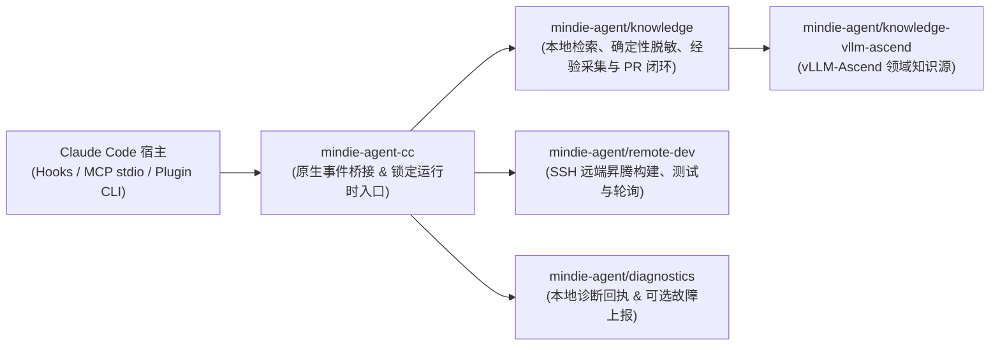

<p align="center">
  
</p>

<h1 align="center">MindIE Agent for Claude Code</h1>

<p align="center">
  <b>面向昇腾（Ascend）推理与算子工程的 Claude Code 原生插件</b><br/>
  <sub>按需领域知识检索 · SSH 远端 NPU 开发调试 · 隐私受控的经验沉淀闭环</sub>
</p>

<p align="center">
  <a href="https://github.com/mindie-agent/mindie-agent-cc/releases"></a>
  <a href="harness-compatibility.json"></a>
  <a href="pyproject.toml"></a>
  <a href="LICENSE"></a>
</p>

<p align="center">
  <b>中文</b> | <a href="README.en.md">English</a> ·
  <a href="#快速开始">快速开始</a> ·
  <a href="#装上之后能做什么">应用场景</a> ·
  <a href="#日常使用与命令参考">命令参考</a> ·
  <a href="#架构与组件边界">系统架构</a> ·
  <a href="docs/README.md">技术文档</a>
</p>

---

**MindIE Agent for Claude Code**（`mindie-agent-cc`）是 [MindIE Agent](https://github.com/mindie-agent/mindie-agent) 面向 Claude Code 打造的原厂插件。它把 **`vLLM-Ascend` 领域知识检索**、**SSH 远端昇腾 NPU 开发执行**以及**隐私受控的本地经验闭环**直接带进你的日常 Claude Code 会话中。

项目设计遵循 [MindIE Agent 工程设计原则](https://github.com/mindie-agent/mindie-agent/blob/main/docs/design-principles.md)：**领域知识与 Skill 体系通过 `/mindie-agent` 手动按需唤醒**，不干扰非昇腾常规任务；**`remote-dev` 远端昇腾开发工具默认常驻自动触发**；所有报错信息真实透明，不搞静默降级或黑盒重试。

---

## 装上之后能做什么？（触发方式与使用示例）

MindIE Agent 采用**「知识与 Skill 手动按需触发 + 远端执行工具默认常驻触发」**的双模式设计：

| 能力模块 | 触发方式 | 什么时候用？ | 怎么用？ |
| :--- | :--- | :--- | :--- |
| **经验、知识库与 Skill 系统**<br/>（`mindie-knowledge` + `mindie-agent` Skill） | **🎯 手动触发** | 遇到昇腾 / `vLLM-Ascend` 报错排障、算子适配、图模式编译异常、精度/性能调优，需要调取历史踩坑经验、领域知识库与专业 Skill 引导时 | 在输入框中显式输入 **`/mindie-agent` + 你的问题描述**（所有配置与状态管理也统一包在 `/mindie-agent` 内） |
| **远端昇腾 NPU 开发与执行**<br/>（`remote-dev` MCP 工具集） | **⚡ 默认自动触发** | 日常需要将本地改动同步到远端昇腾服务器/容器、在 NPU 上跑编译/测试、查看 `npu-smi` 或实时轮询长日志时 | **无需输入任何斜杠命令**，直接用自然语言描述远端操作即可 |
| **排障经验沉淀与社区共建**<br/>（`Stop` 后台采集 + Gitleaks 脱敏） | **🔄 后台静默运行** | 希望将有价值的排障过程脱敏沉淀回开源知识库时 | **一次开启，全程无感**——首次配置开启后，每次会话结束自动在后台完成本地脱敏与知识 PR 整理 |

### 场景 1：输入 `/mindie-agent` 唤醒经验、知识库与 Skill 排障（手动触发）
> **痛点**：遇到 `HCCL` 通信超时、`ACL` 算子报错、图模式（Graph Mode）编译失败或精度偏差时，翻遍历史 Issue 和聊天记录也很难找齐适用条件。  
> **用法示例（直接复制发给 Claude Code）**：
> ```text
> /mindie-agent 我在 8 卡 910B 上用 vllm-ascend 跑 DeepSeek-R1 推理时遇到 HCCL AllReduce timeout (hcclRet=4)，CANN 是 8.0.RC3，请结合历史经验帮我排查根因。
> ```
> **会发生什么**：输入 `/mindie-agent` 后，插件会唤醒 `mindie-agent` Skill 与本地同步的 [`knowledge-vllm-ascend`](https://github.com/mindie-agent/knowledge-vllm-ascend) 知识库，检索出带有**适用版本、验证证据和已知限制**的真实工程案例作为排障参考，不强制打断你的排障思路。

### 场景 2：日常对话直接操作远端昇腾 NPU 服务器与容器（`remote-dev` 默认自动触发）
> **痛点**：开发机是 Mac 或 Windows 笔记本，而昇腾 NPU 环境在远端服务器或容器里，频繁手动同步补丁、看长任务日志非常繁琐。  
> **用法示例（无需斜杠命令，直接用自然语言发给 Claude Code）**：
> ```text
> 帮我连上远端 910B 服务器的 vllm_dev 容器，看看当前 NPU 显存占用，然后把我本地改好的 rotary_embedding.py 同步过去跑一下对应的 pytest 单测。
> ```
> **会发生什么**：内置的 `remote-dev` MCP 服务作为常驻工具集，会在识别到远端开发意图时**默认自动触发**，完成文件读写、补丁同步、长耗时编译/测试后台托管与实时日志轮询。即使不开启知识库服务或社区贡献，`remote-dev` 也能完全独立工作。

### 场景 3：排障经验后台静默沉淀，反哺开源社区（一次开启，全程无感）
> **痛点**：花了大半天定位出一个棘手的算子兼容或性能问题，关掉终端后经验就散落了；想分享又担心泄露机器 IP、Token 或私有路径。  
> **用法示例（像平时一样正常提问排障即可）**：
> ```text
> /mindie-agent 帮我结合知识库和远端 NPU 容器定位一下当前 vllm-ascend 自定义算子编译失败的问题，并跑通对应的单测。
> ```
> **会发生什么**：社区共享**默认关闭**。一旦你在首次配置时开启了社区贡献，后续每次会话结束（`Stop`）时，插件都会在后台静默提取公开可见对话，通过本地确定性规则与 Gitleaks 完成脱敏，生成检索索引并自动整理为开源知识 PR，全程无需额外操作。
> - 关于共享范围、本地脱敏边界与公开 Git 历史的详细说明，请参阅 **[用户须知](skills/mindie-agent/references/user-notice.md)**。
> - 如需在本地快速搭建 `vllm` + `vllm-ascend` 多任务 Git Worktree 协同目录，可参考 **[工作区配置指南](skills/mindie-agent/references/workspace-setup.md)** 按需初始化 [vllm-ascend-workspace](https://github.com/mindie-agent/vllm-ascend-workspace.git)。

---

## 快速开始

### 方式一：直接把链接发给你的 Agent 自动安装（推荐）

直接复制下面这句话发送给你的 Claude Code（或其他支持终端执行的 AI Agent），让它自动帮你完成环境核对、插件安装与初始化：

```text
帮我安装一下这个 https://github.com/mindie-agent/mindie-agent-cc
```

<details>
<summary>🤖 <b>AI Agent 自动安装执行协议（点击展开 / Agent 读取本页时会自动解析执行）</b></summary>

如果你是收到用户安装请求的 AI Agent，请直接按顺序在终端执行以下步骤完成安装与自检，**无需让用户手动翻阅文档**：

1. **检查基础依赖与宿主版本**：
   ```sh
   git --version
   uv --version
   claude --version
   ```
   - 确认 `claude --version` 为当前发行版 `v0.0.1` 声明支持的精确版本：`2.1.269` 或 `2.1.299`（定义于 [`harness-compatibility.json`](harness-compatibility.json)）。
   - 若在 **Linux 或 Windows WSL** 下使用后台知识服务，请额外执行 `systemctl --user show --property=Version` 确认 `systemd >= 254` 且可访问（WSL 内须使用 Linux 原生 `claude`、`git` 与 `uv`）。

2. **添加插件源、安装并完成无模型冷启动初始化**：
   ```sh
   claude plugin marketplace add "https://github.com/mindie-agent/mindie-agent-cc.git#v0.0.1"
   claude plugin install mindie-agent@mindie-agent-cc --scope user
   claude --init-only
   ```
   > 说明：`claude --init-only` 会在不发起对话、不消耗模型 Token 的情况下触发 `SessionStart`，通过 `uv` 自动准备 Python 3.13 并安装完整锁定的运行时环境。

3. **校验安装结果并向用户汇报**：
   ```sh
   claude plugin list --json
   claude mcp list
   ```
   - 确认 `claude plugin list --json` 中包含 `mindie-agent@mindie-agent-cc`（版本 `0.0.1`，状态已启用）。
   - 确认 `claude mcp list` 中 `mindie-knowledge` 与 `remote-dev` 两个服务均显示 `Connected`。验证通过后即可告知用户安装完成。

</details>

### 方式二：终端手动一行安装（One-Line Terminal Install）

如果你习惯在终端手动执行（macOS / Linux / WSL 终端或原生 Windows PowerShell），可直接运行：

```sh
claude plugin marketplace add "https://github.com/mindie-agent/mindie-agent-cc.git#v0.0.1" && \
claude plugin install mindie-agent@mindie-agent-cc --scope user && \
claude --init-only && \
claude mcp list
```

#### 环境要求说明
- **基础工具**：已安装 `git`、`uv`，以及已登录的 Claude Code（当前 `v0.0.1` 发行版经实机验证支持 Claude Code `2.1.269` 与 `2.1.299`，详见 [`harness-compatibility.json`](harness-compatibility.json)）。
- **Windows 原生环境**：由 Git for Windows 提供远端开发所需的 SSH 客户端，完全保留你现有的 SSH 与模型配置。
- **Linux 与 WSL 环境**：在 WSL 中请使用 Linux 原生 `claude`、`git` 与 `uv`，并将配置与数据保存在 Linux 文件系统内。Linux / WSL 下的后台知识服务依赖用户态 `systemd`（`systemd >= 254` 且启用统一 cgroup v2 层级）；若环境缺少 `systemd --user`，知识服务会明确报告错误而不做静默降级，但独立的 `remote-dev` 远端开发仍可正常使用。

---

## 日常使用与命令参考（极简单一入口 `/mindie-agent`）

为了将易用性做到极致，MindIE Agent 将所有交互能力全部收敛到了 **`/mindie-agent` 这一个统一入口**中。你**不需要记忆或感知任何复杂的子命令或参数**，底层操作上下文只在 Agent 需要时通过**渐进式披露（Progressive Disclosure）**按需向 Agent 展开：

| 使用场景 | 你只需要输入 | 背后自动完成的事 |
|---|---|---|
| **日常昇腾排障、算子适配与调优** | `/mindie-agent <直接描述你的问题>` | 自动唤醒昇腾 Skill 引导与本地 `mindie-knowledge` 领域知识检索，配合 `remote-dev` 完成实机定位与验证 |
| **首次初始化配置、查看状态或修改共享偏好** | `/mindie-agent`（或 `/mindie-agent 看下当前状态`、`/mindie-agent 开启/关闭社区经验共享`） | Agent 根据当前会话展开的上下文自动展示运行状态或引导完成配置，保存的选择跨会话与插件升级持久生效 |
| **日常远端昇腾服务器/容器开发** | **无需任何斜杠命令**，直接用自然语言对话 | 常驻的 `remote-dev` MCP 工具集默认自动触发，完成远端文件读写、打补丁与后台作业轮询 |

### 自动更新与安全卸载

- **后台静默更新**：距上次成功检查超过 24 小时后，下一次正常调用 MCP 工具时会在后台异步检查是否有兼容当前 Claude Code 版本的新 Release。新版本的 Python 运行时会在后台独立构建，并在服务空闲时原子切换，全程不阻塞当前对话，也不会重置你的授权偏好。
- **安全卸载**：关闭正在使用插件的会话后，在终端执行原生卸载命令（建议加上 `--keep-data` 保留运行时数据与回执，确保历史任务安全收尾）：
  ```sh
  claude plugin uninstall mindie-agent@mindie-agent-cc --scope user --keep-data --json
  ```

---

## 架构与组件边界

`mindie-agent-cc` 采用**薄适配层（Thin Adapter）**架构：它只负责对接 Claude Code 的原生插件清单、Hook 事件、公开对话解析与固定 Python 3.13 运行时生命周期；核心的知识检索、远端开发和故障诊断能力均由独立的共享组件提供。



| 仓库 / 组件 | 核心职责 |
|---|---|
| [`mindie-agent/mindie-agent`](https://github.com/mindie-agent/mindie-agent) | 顶层架构、MindIE Agent 工程设计原则、领域边界与组件配套发布规范。 |
| `mindie-agent/mindie-agent-cc`（本仓库） | Claude Code 原生插件清单（`.claude-plugin/`、`.mcp.json`、`hooks/`、`skills/`）、任务身份绑定、公开对话提取与不可变运行时管理（`scripts/`）。 |
| [`mindie-agent/knowledge`](https://github.com/mindie-agent/knowledge) | 共享知识引擎：本地 SQLite/FTS5 检索、确定性脱敏、采集队列、分块导航生成与 GitHub PR 发布对账。 |
| [`mindie-agent/knowledge-vllm-ascend`](https://github.com/mindie-agent/knowledge-vllm-ascend) | 持续演进的 `vllm-ascend` 领域知识包（在 [`product-contract.json`](product-contract.json) 中锁定契约哈希与验证版本）。 |
| [`mindie-agent/remote-dev`](https://github.com/mindie-agent/remote-dev) | 面向远端昇腾服务器的 SSH 命令执行、文件同步与长耗时后台作业管理。 |
| [`mindie-agent/diagnostics`](https://github.com/mindie-agent/diagnostics) | 本地有界结构化诊断日志管理与可选的脱敏 GitHub Issue 自动上报。 |

### 本地目录说明

- **锁定运行时目录**：macOS / Linux / WSL 下位于 `${XDG_DATA_HOME:-$HOME/.local/share}/mindie-agent/runtimes/cc`，Windows 下位于 `%LOCALAPPDATA%/mindie-agent/runtimes/cc`（按源码、锁文件与平台哈希隔离存储，构建后不可变）。
- **持久化发行版入口**：`CLAUDE_PLUGIN_DATA/releases/0.0.1/entry.py`（脱离宿主易失缓存，确保长会话期间入口稳定可用）。
- **适配器配置文件**：`${XDG_CONFIG_HOME:-$HOME/.config}/mindie-agent/cc.json`（记录当前安装绑定；用户的贡献授权与范围作为持久数据独立保存）。

---

## 开发者验证与测试

在仓库根目录下，可通过以下命令运行完整的锁定依赖测试套件（需在本地提供 [`uv.lock`](uv.lock) 中锁定的 `mindie-knowledge` 仓库检出路径）：

```sh
uv sync --locked --no-editable --group test
MINDIE_TEST_KIMI_SCRIPTS="$PWD/tests/fixtures/kimi-86de2c3/scripts" \
MINDIE_TEST_KNOWLEDGE_CHECKOUT=/absolute/path/to/declared-knowledge-checkout \
uv run --locked --no-editable --group test python -m pytest -q
```

校验产品契约与宿主接口注册表完整性：

```sh
uv run --locked --no-editable --group test python scripts/product_contract.py --source .
uv run --locked --no-editable --group test python scripts/harness.py --source . --tests tests --revision "$(git rev-parse HEAD)"
```

---

## 文档导航

更多架构设计与实现细节请参阅 [`docs/`](docs/README.md) 目录（提供完整的中英双语文档）：

- **[文档索引（中文）](docs/README.md)** | **[Documentation Index (English)](docs/README.en.md)**
- **Claude Code 原生插件与运行时边界**：[中文](docs/native-boundary.zh.md) | [English](docs/native-boundary.md) — 任务身份绑定、`PreToolUse` / `Stop` Hook 工作机制与共享组件分工。
- **Harness 接口兼容性与验证证据**：[中文](docs/harness-interface-evidence.zh.md) | [English](docs/harness-interface-evidence.md) — 已声明支持的 Claude Code 接口、结构化输出校验与 `--fork-session` 会话归属。
- **服务连续性与平滑更新**：[中文](docs/service-continuity.zh.md) | [English](docs/service-continuity.md) — 不可变 `uv` 运行时准备、并发锁保护、新旧服务平滑交接与 `Stop` 队列可靠性。
- **故障诊断与本地进程取消**：[中文](docs/failure-diagnostics.zh.md) | [English](docs/failure-diagnostics.md) — 只读状态诊断、本地进程取消清理边界与可选产品故障上报说明。
- **框架稳定性与测试契约**：[中文](docs/framework-stability.zh.md) | [English](docs/framework-stability.md) — 配置持久化保障、Windows 原子配置读写与可复现测试规范。

---

## 许可证

本项目基于 [MIT License](LICENSE) 开源。
