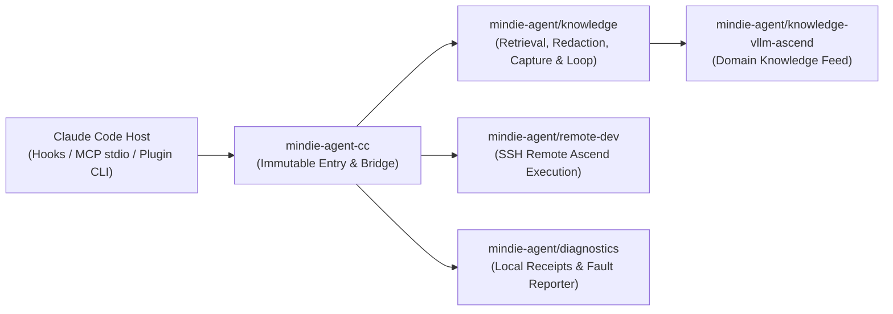

<p align="center">
  
</p>

<h1 align="center">MindIE Agent for Claude Code</h1>

<p align="center">
  <a href="https://github.com/mindie-agent/mindie-agent-cc/releases"></a>
  <a href="harness-compatibility.json"></a>
  <a href="pyproject.toml"></a>
  <a href="LICENSE"></a>
</p>

<p align="center">
  中文 | <a href="README.en.md">English</a>
</p>

**MindIE Agent for Claude Code**（`mindie-agent-cc`）是 [MindIE Agent](https://github.com/mindie-agent/mindie-agent) 面向 Claude Code 的原生插件适配器，为昇腾（Ascend）推理工程提供领域知识检索、本地经验沉淀与受控开源共享、SSH 远端昇腾开发以及结构化故障诊断能力。

本仓库完整继承 [MindIE Agent 九条设计原则](https://github.com/mindie-agent/mindie-agent/blob/main/docs/design-principles.md)。Claude Code 宿主负责原生插件的安装、升级与卸载记录；本适配器负责原生任务身份绑定、Hook 事件桥接、公开对话投影解析以及每个发行版固定的 Python 3.13 运行时环境；知识引擎、远端执行与故障诊断则由各自独立的共享组件承载。

---

## 核心特性

- **按需领域知识检索（`mindie-knowledge`）**：通过原生 MCP 工具检索 `vllm-ascend` 等昇腾推理工程经验。知识仅作为参考材料提供，包含适用条件、证据与不确定性说明；普通研发任务按需调用，无强制查阅、必写或投票流程。
- **本地经验闭环与隐私受控的开源共享**：
  - 仅在用户明确授权（Opt-in）的公开仓库与项目路径范围内，在原生 `Stop` 阶段自动关联当前任务公开对话投影并完成本地确定性脱敏；仅保存完整用户消息与可见助手回复，不包含工具载荷，也不使用模型改写正文。
  - 安装与更新自动准备扫描器与隔离的块索引 Worker（复用所选 Claude 模型配置生成有界导航元数据，绝不替代原文；失败或结果不确定的调用均保留执行与用量回执，禁止静默重试或以摘录冒充索引完成）。
  - 共享范围、脱敏边界、模型处理与公开 Git 历史说明请阅读 **[用户须知](skills/mindie-agent/references/user-notice.md)**；在首次配置展示用户须知后，可按需参考 **[工作区配置指南](skills/mindie-agent/references/workspace-setup.md)** 选择是否创建并初始化 [mindie-agent/vllm-ascend-workspace](https://github.com/mindie-agent/vllm-ascend-workspace.git) 工作目录（完全可选，自动复用已有选择）。
- **SSH 远端昇腾开发（`remote-dev`）**：通过独立的 `remote-dev` MCP 服务连接远端昇腾服务器执行构建、测试与调试任务。远端开发与知识服务、贡献授权完全解耦，即使未启用知识贡献或知识服务不可用也可独立工作。
- **结构化诊断与可选产品故障上报（`mindie-diagnostics`）**：所有错误对调用者真实可见，明确区分“已完成”、“失败”与“外部副作用不确定”，禁止静默降级或假成功。支持独立授权的脱敏产品故障上报，仅包含静态产品阶段、错误类型与已安装代码版本。

---

## 快速开始

### 1. 环境前提

请确保本地已安装 `git`、`uv` 以及已登录且支持原生插件（提供 `CLAUDE_PLUGIN_DATA` 持久化入口）的 Claude Code：

- **支持版本声明**：当前正式发行版 `v0.0.1` 精确声明支持 Claude Code `2.1.269` 与 `2.1.299`（参见 [`harness-compatibility.json`](harness-compatibility.json)）。
- **Windows 环境**：Git for Windows 同时提供远端操作所需的 SSH 实现；已有 SSH 与模型配置保持不变。
- **Linux 与 WSL 环境**：在 WSL 中请使用 Linux 原生 Claude、Git 与 `uv`，并将配置 Profile、SQLite 状态与运行时保存在 Linux 文件系统内。在 Linux 与 WSL 上，基于后台服务的知识检索与自动采集/索引要求可访问的 `systemd` 用户管理器（`systemd >= 254`）与统一 cgroup 层级（可通过 `systemctl --user show --property=Version` 检查）；缺失管理器、版本不支持或容器隔离未验证将直接报告服务错误，不做无保护降级。独立的 `remote-dev` 操作不依赖该知识服务。

### 2. 一键安装与初始化（Release `v0.0.1`）

确认 [GitHub Releases](https://github.com/mindie-agent/mindie-agent-cc/releases) 中的不可变标签 `v0.0.1` 可用后，在 macOS/Linux/WSL 终端或原生 Windows PowerShell 中使用同一 Claude Profile 执行：

```sh
git --version
uv --version
claude --version
claude plugin marketplace add "https://github.com/mindie-agent/mindie-agent-cc.git#v0.0.1"
claude plugin install mindie-agent@mindie-agent-cc --scope user
claude --init-only
claude plugin list --json
claude mcp list
```

**安装核对说明**：
1. `claude --init-only` 会在不发起对话、不调用模型的情况下完成 `SessionStart` 初始化：通过 `uv` 准备 Python 3.13 并使用 `uv sync --locked --no-editable` 安装完整锁定的运行时（冷启动需网络访问声明的依赖源）。
2. 检查 `claude plugin list --json`，确认记录显示 `mindie-agent@mindie-agent-cc`、版本 `0.0.1`、作用域 `user` 且状态为已启用。
3. 检查 `claude mcp list`，确认两个 MindIE MCP 服务（`mindie-knowledge` 与 `remote-dev`）均报告 `Connected`（常规会话中 Claude 会与 `SessionStart` 并发连接 MCP，先执行 `--init-only` 可避免冷构建超时）。

### 3. 日常使用与斜杠命令

安装完成后，普通研发任务**无需任何每任务激活命令**，知识检索与 `remote-dev` 工具均可按需直接调用。需要查看状态或修改授权配置时，可使用以下斜杠命令：

| 命令 | 说明 |
|---|---|
| `/mindie-agent` 或 `/mindie-agent:init` | 可选的首次配置向导与状态入口；已保存的授权选择跨会话、Fork、重启、升级与故障持久保留，不会重复询问。 |
| `/mindie-agent:status` | 只读查询当前知识配置、服务与存储健康度、当前任务绑定状态、诊断计数以及最近 5 次采集与贡献批次。 |
| `/mindie-agent contribute --repository owner/repo --account USER --project-root /absolute/path --visibility public` | 显式配置公开知识贡献目标仓库、账号与项目根目录（默认关闭，需在同一调用中显式指定全部参数）。 |
| `/mindie-agent:sharing-enable` / `/mindie-agent:sharing-disable` | 启用或停止已配置范围内的知识共享（关闭后 `Stop` 阶段不读取对话、不采集也不调用整理器）。 |
| `/mindie-agent:deactivate` | 结束当前任务的知识访问绑定（不卸载插件）。 |
| `/mindie-agent:recover` | 查询或恢复失败批次（外部发布结果不确定时须先完成对账，绝不盲目重放）。 |
| `/mindie-agent:reporting-status` | 查询独立的产品故障上报开关状态与 Reporter 就绪状态。 |
| `/mindie-agent:reporting-enable` / `/mindie-agent:reporting-disable` | 开启或关闭向 `mindie-agent/mindie-agent` 提交脱敏产品故障报告（开启后会返回一条一次性准备命令，需在 Hook 外执行并确认 runtime 与 worker 均就绪）。 |

### 4. 自动更新与卸载

- **静默兼容更新**：距上次成功检查超过 24 小时后，下一次自然 MCP 调用会异步触发一次 Release 检查（常规调用仅做进程内时间戳比对，不阻塞等待网络或哈希校验）。共享版本选择器根据 [`harness-compatibility.json`](harness-compatibility.json) 选择当前 Claude Code 支持的最高正式 Release，并在操作准入外完成不可变运行时构建，待核心空闲时原子切换绑定。
- **安全卸载**：关闭正在使用插件的任务后，使用同一 Claude Profile 执行原生卸载命令并保留持久数据：

```sh
claude plugin uninstall mindie-agent@mindie-agent-cc --scope user --keep-data --json
```

> **注意**：请保留运行时目录、回执与启动器以供既有任务安全收尾；卸载本适配器不会自动修改跨适配器共享的故障上报开关（如需关闭请先执行 `/mindie-agent:reporting-disable`）。

---

## 架构与组件映射

`mindie-agent-cc` 严格保持薄适配层边界，不复制知识引擎或维护第二套状态库：



| 组件 / 路径 | 职责边界 |
|---|---|
| [`mindie-agent/mindie-agent`](https://github.com/mindie-agent/mindie-agent) | 顶层架构、九条设计原则、领域边界与配套发布规范。 |
| `mindie-agent/mindie-agent-cc`（本仓库） | Claude Code 原生插件清单（`.claude-plugin/`、`.mcp.json`、`hooks/`、`skills/`）、任务身份桥接、公开对话解析与固定运行时管理（`scripts/`）。 |
| [`mindie-agent/knowledge`](https://github.com/mindie-agent/knowledge) | 共享知识核心：本地 SQLite/FTS 检索、确定性脱敏、采集队列、块索引调度、PR 发布回执与版本兼容验证。 |
| [`mindie-agent/knowledge-vllm-ascend`](https://github.com/mindie-agent/knowledge-vllm-ascend) | `vllm-ascend` 领域知识源（在 [`product-contract.json`](product-contract.json) 中固定契约哈希与验证提交）。 |
| [`mindie-agent/remote-dev`](https://github.com/mindie-agent/remote-dev) | 面向远端昇腾开发环境的有界命令执行、同步与长任务轮询管理。 |
| [`mindie-agent/diagnostics`](https://github.com/mindie-agent/diagnostics) | 本地有界诊断日志保留与可选的脱敏 GitHub Issue 故障上报。 |

### 本地路径约定

- **固定运行时目录**：macOS / Linux / WSL 下位于 `${XDG_DATA_HOME:-$HOME/.local/share}/mindie-agent/runtimes/cc`，Windows 下位于 `%LOCALAPPDATA%/mindie-agent/runtimes/cc`（按包源码、锁文件、Python ABI 与平台哈希索引，构建完成后不可变）。
- **持久化发行版入口**：`CLAUDE_PLUGIN_DATA/releases/0.0.1/entry.py`（绑定唯一完整的已安装 facade 与 profile；热路径 Hook 以离线模式运行 `uv`）。
- **共享业务配置**：`${XDG_CONFIG_HOME:-$HOME/.config}/mindie-agent/cc.json`（记录所选安装绑定；贡献范围与用户授权作为独立持久数据保存）。

---

## 可复现组件验证

在仓库根目录下，可执行以下命令运行完整的锁定依赖与组件契约测试（需提供 [`uv.lock`](uv.lock) 中声明的 `mindie-knowledge` 精确提交检出路径）：

```sh
uv sync --locked --no-editable --group test
MINDIE_TEST_KIMI_SCRIPTS="$PWD/tests/fixtures/kimi-86de2c3/scripts" \
MINDIE_TEST_KNOWLEDGE_CHECKOUT=/absolute/path/to/declared-knowledge-checkout \
uv run --locked --no-editable --group test python -m pytest -q
```

校验 Harness 接口注册表与产品契约完整性：

```sh
uv run --locked --no-editable --group test python scripts/product_contract.py --source .
uv run --locked --no-editable --group test python scripts/harness.py --source . --tests tests --revision "$(git rev-parse HEAD)"
```

---

## 文档导航

详细设计与契约说明见 [`docs/`](docs/README.md) 目录（提供中英文双语版本）：

- **[文档索引（中文）](docs/README.md)** | **[Documentation Index (English)](docs/README.en.md)**
- **Claude Code 原生边界**：[中文](docs/native-boundary.zh.md) | [English](docs/native-boundary.md) — 任务身份绑定、`PreToolUse`/`Stop` Hook 行为与共享组件职责划分。
- **Harness 接口证据与 Fork 归属**：[中文](docs/harness-interface-evidence.zh.md) | [English](docs/harness-interface-evidence.md) — 已声明支持的 Claude Code 接口、结构化输出边界与 `--fork-session` 归属机制。
- **固定运行时服务连续性**：[中文](docs/service-continuity.zh.md) | [English](docs/service-continuity.md) — 不可变 `uv` 运行时准备、并发准入控制、平滑切换与 `Stop` 投递保证。
- **故障诊断与本地取消**：[中文](docs/failure-diagnostics.zh.md) | [English](docs/failure-diagnostics.md) — 状态诊断、进程取消边界、原生失败投影与自动产品故障上报契约。
- **框架稳定性与验证边界**：[中文](docs/framework-stability.zh.md) | [English](docs/framework-stability.md) — 日常使用不变式、Windows 原子配置读写与组件测试复现说明。

---

## 许可证

本项目采用 [MIT License](LICENSE) 开源。
