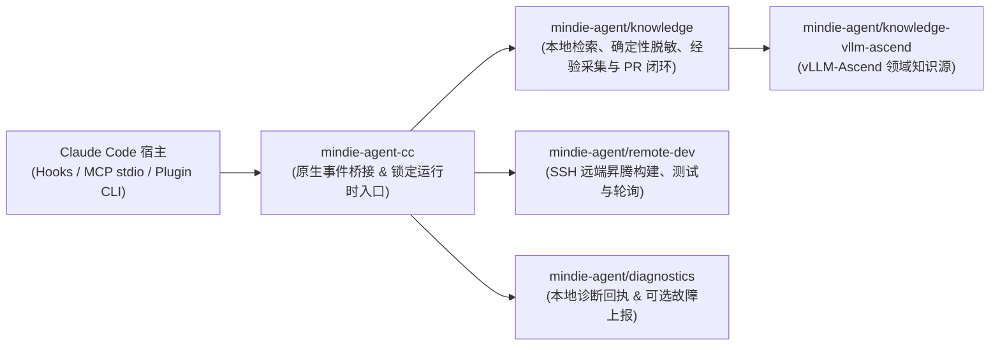

<p align="center">
  
</p>

<h1 align="center">MindIE Agent for Claude Code</h1>

<p align="center">
  <b>面向昇腾（Ascend）NPU AI Infra 研发、设计与测试全流程的 Claude Code 原生插件</b><br/>
  <sub>覆盖架构设计 · 特性开发 · AscendC / Triton 算子实现 · 远端 NPU 测试验证 · 研发经验静默沉淀</sub>
</p>

<p align="center">
  <a href="https://github.com/mindie-agent/mindie-agent-cc/releases"></a>
  <a href="harness-compatibility.json"></a>
  <a href="pyproject.toml"></a>
  <a href="LICENSE"></a>
</p>

<p align="center">
  <b>中文</b> | <a href="README.en.md">English</a> ·
  <a href="#快速开始">快速开始</a> ·
  <a href="#装上之后能做什么">应用场景</a> ·
  <a href="#日常使用与命令参考">命令参考</a> ·
  <a href="#架构与组件边界">系统架构</a> ·
  <a href="docs/README.md">技术文档</a>
</p>

---

**MindIE Agent for Claude Code**（`mindie-agent-cc`）是 [MindIE Agent](https://github.com/mindie-agent/mindie-agent) 面向 Claude Code 的原生插件，服务于**昇腾（Ascend）NPU 上的 AI Infra 设计、开发与测试全流程**。当前 `v0.1.8`（配套主产品 `0.1.2`）已交付三大核心能力：**本地与社区知识库检索及隐私脱敏**（优先覆盖 `vLLM-Ascend` 特性开发与 `AscendC` / `Triton` 算子工程）、**远端 SSH / Docker 开发与 NPU 状态巡检**，以及**统一故障诊断与脱敏上报**；更多昇腾基础软件领域将随演进路线图持续扩展。

项目设计遵循 [MindIE Agent 工程设计原则](https://github.com/mindie-agent/mindie-agent/blob/main/docs/design-principles.md)：**领域知识与 Skill 体系通过 `/mindie-agent` 手动按需唤醒**，不干扰非昇腾常规任务；**`remote-dev` 远端昇腾开发与测试工具默认常驻自动触发**；所有状态与报错真实透明，不做静默降级或盲目重试。

---

## 装上之后能做什么？（触发方式与使用示例）

MindIE Agent 采用**「领域知识与 Skill 手动按需触发 + 远端开发测试工具默认常驻触发」**的设计：

| 能力模块 | 触发方式 | 什么时候用？ | 怎么用？ |
| :--- | :--- | :--- | :--- |
| **经验、知识库与 Skill 系统**<br/>（`mindie-knowledge` + `mindie-agent` Skill） | **🎯 当前会话手动触发** | 开展昇腾 AI Infra 架构设计、`vLLM-Ascend` 特性开发、`AscendC` / `Triton` 算子实现、单测/精度测试构建、性能调优或问题定位时 | 在当前会话中显式输入一次 **`/mindie-agent` + 你的需求描述**，即可在本会话后续轮次持续启用知识检索、反馈、蒸馏与同步（输入 `/mindie-agent deactivate` 可在当前会话关闭） |
| **远端昇腾 NPU 开发与测试**<br/>（`remote-dev` MCP 工具集 + `mindie_status`） | **⚡ 默认自动触发** | 日常需要将本地代码或测试同步到远端昇腾服务器/容器、在 NPU 上跑编译/测试、查看 `npu-smi` 或实时轮询长日志时 | **无需输入任何斜杠命令**，直接用自然语言描述远端操作即可 |
| **研发经验沉淀与社区共建**<br/>（`Stop` 后台采集 + Gitleaks 脱敏） | **🔄 已启用会话后台自动运行** | 希望将有价值的架构设计、算子开发、测试验证或调优经验脱敏沉淀回开源知识库时 | **授权一次配置，按会话生效**——首次配置开启社区贡献后，在已通过 `/mindie-agent` 启用知识系统的会话中，每次回合结束自动在后台完成本地脱敏与知识 PR 整理；未调用 `/mindie-agent` 的普通会话不触发后台采集 |

### 场景 1：输入 `/mindie-agent` 唤醒知识库与 Skill 辅助设计、开发与测试（手动触发）
> **痛点**：在昇腾上设计新特性、开发 `AscendC` / `Triton` 算子或编写 `vLLM-Ascend` 测试时，缺少现成的架构规范、算子接口约束与历史经验参考。  
> **用法示例（直接复制发给 Claude Code）**：
> ```text
> /mindie-agent 我准备在 vllm-ascend 中为新模型设计并接入一个自定义融合算子（支持 Triton / AscendC 实现）并补齐单元与精度测试，请结合知识库里的现有设计规范和开发经验帮我制定实现方案。
> ```
> **会发生什么**：输入 `/mindie-agent` 后，插件会唤醒 `mindie-agent` Skill 与本地同步的 [`knowledge-vllm-ascend`](https://github.com/mindie-agent/knowledge-vllm-ascend) 知识库，检索出带有**适用版本、验证证据和已知限制**的真实设计、开发与测试案例作为参考。

### 场景 2：日常对话直接操作远端昇腾 NPU 服务器与容器（`remote-dev` 默认自动触发）
> **痛点**：开发机是 Mac 或 Windows 笔记本，而昇腾 NPU 环境在远端服务器或容器里，频繁手动同步代码、编译算子、看长耗时测试日志非常繁琐。  
> **用法示例（无需斜杠命令，直接用自然语言发给 Claude Code）**：
> ```text
> 帮我连上远端 910B 服务器的 vllm_dev 容器，看看当前 NPU 显存占用，然后把我本地新写的算子实现和 rotary_embedding 单测同步过去跑一下完整的 pytest 验证。
> ```
> **会发生什么**：内置的 `remote-dev` MCP 服务作为常驻工具集，会在识别到远端开发意图时**默认自动触发**，完成文件读写、补丁同步、长耗时编译/测试后台托管与实时日志轮询。即使不开启知识库服务或社区贡献，`remote-dev` 也能完全独立工作。

### 场景 3：研发经验后台沉淀与统一贡献开关（一次配置，无日常额外操作）
> **痛点**：完成了一项复杂的特性设计、算子适配或深度调优后，关掉终端经验就散落了；想分享又担心泄露机器 IP、Token 或私有路径。  
> **用法示例（像平时一样正常开展研发与测试即可）**：
> ```text
> /mindie-agent 帮我结合知识库和远端 NPU 容器完成当前 vllm-ascend 自定义算子的编译与精度对齐验证，并跑通对应的单测。
> ```
> **会发生什么**：社区共享**默认关闭**。当你显式开启社区贡献后，保存的授权配置会跨会话持久生效；在任何通过 `/mindie-agent` 启用了知识系统的会话中，每次回合结束（`Stop`）时，插件都会在后台提取该会话自激活起的公开可见对话，通过本地确定性规则与 Gitleaks 完成脱敏，生成检索索引并自动整理为开源知识 PR，无需重复确认授权或额外执行收尾命令（未调用 `/mindie-agent` 的普通会话在 `Stop` 阶段直接短路跳过，不读取对话或配置）。
> - **统一贡献开关（适配器配置文件同目录的 `mindie-consent.json`）**：社区知识贡献与自动工具故障上报共用同一个持久化开关。显式开启（`contribute`）会配置知识共享并启动原生后台 reporter；关闭（`disabled`）会同时停止两条路径的后续外发，且已有的 `disabled` / `later` / `read-only` 状态在升级后保持关闭。有效的已保存选择直接复用，不重复询问；仅当入口对旧版仅知识 `contribute` 记录返回 `needs_choice` 时，才在 `/mindie-agent` 中处理一次明确选择，不分开询问知识和故障授权，也不逐次任务确认；旧 `disabled`、`read-only`、`later` 选择直接保留、不提示。系统严格区分**本地授权配置已写入**、**后台 reporter 进程运行中**与**外部 GitHub Issue/PR 已实际创建**三种状态。
> - 关于共享范围、本地脱敏边界与公开 Git 历史的详细说明，请参阅 **[用户须知](skills/mindie-agent/references/user-notice.md)**。
> - 如需在本地快速搭建 `vllm` + `vllm-ascend` 多任务 Git Worktree 协同目录，可参考 **[工作区配置指南](skills/mindie-agent/references/workspace-setup.md)** 按需初始化 [vllm-ascend-workspace](https://github.com/mindie-agent/vllm-ascend-workspace.git)。

---

## 快速开始

### 方式一：通过提示词交由 Agent 自动安装（Quick Install via Prompt）

直接复制下面这句话发送给你的 Claude Code（或其他支持终端执行的 AI Agent），由其自动完成环境核对、插件安装与初始化：

```text
帮我安装一下这个 https://github.com/mindie-agent/mindie-agent-cc
```

<details>
<summary>🤖 <b>AI Agent 自动安装执行协议（点击展开 / Agent 读取本页时会自动解析执行）</b></summary>

如果你是收到用户安装请求的 AI Agent，请直接按顺序在终端执行以下步骤完成安装与自检，**无需让用户手动翻阅文档**：

1. **检查基础依赖、宿主版本与 `gh` GitHub 交互通道（硬性指标）**：
   **稳定的 GitHub 交互通道（已安装并登录 `gh` CLI）是硬性前置指标**——插件拉取、锁定发行版校验、`knowledge-vllm-ascend` 同步、经验闭环自动提交 PR（底层通过 `gh api` 与 `!gh auth git-credential` 驱动）及组件故障上报均依赖该通道：
   ```sh
   git --version
   uv --version
   gh --version
   GH_USER=$(gh api --hostname github.com user --jq .login) && echo "GitHub channel verified for account: $GH_USER"
   gh auth setup-git --hostname github.com
   claude --version
   ```
   - **硬性门禁（严禁跳过或静默忽略）**：若未安装 `gh`，请先协助安装（macOS：`brew install gh`；Windows：`winget install --id GitHub.cli`；Ubuntu / WSL：`sudo apt update && sudo apt install -y gh`）。账号读取成功时复用已有认证；需要登录时按 [GitHub 登录引导](skills/mindie-agent/references/github-authentication.md) 选择方式：普通网络使用浏览器，企业网络或浏览器授权受阻时优先 Token。已有 Token 就在 `gh` 隐藏输入提示中粘贴（或使用已提供的私有文件），没有则引导创建。验证账号、Git 和后续进程可复用凭据后继续；网络/证书错误先修复传输，不反复要求登录。
   - 确认 `claude --version` 为当前发行版 `v0.1.8` 声明支持的精确版本：`2.1.269` 或 `2.1.299`（定义于 [`harness-compatibility.json`](harness-compatibility.json)）。
   - 若在 **Linux 或 Windows WSL** 下使用后台知识服务，请额外执行 `systemctl --user show --property=Version` 确认 `systemd >= 254` 且可访问（WSL 内须使用 Linux 原生 `claude`、`git`、`uv` 与 `gh`）。

2. **可选支持与贡献准备**：
   安装不需要 Star 或 Fork 主仓；是否支持项目由用户决定。只有用户明确开启知识贡献后，Agent 才按需创建目标知识仓的 Fork，并将其绑定到贡献配置。

3. **添加插件源、安装并完成无模型冷启动初始化**：
   ```sh
   claude plugin marketplace add "https://github.com/mindie-agent/mindie-agent-cc.git#v0.1.8"
   claude plugin install mindie-agent@mindie-agent-cc --scope user
   claude --init-only
   ```
   > 说明：`claude --init-only` 会在不发起对话、不消耗模型 Token 的情况下触发 `SessionStart`，通过 `uv` 自动准备 Python 3.13 并安装完整锁定的运行时环境。

4. **核对插件安装状态**：
   ```sh
   claude plugin list --json
   claude mcp list
   ```
   - 确认 `claude plugin list --json` 中包含 `mindie-agent@mindie-agent-cc`（版本 `0.1.8`，状态已启用）。
   - 确认 `claude mcp list` 中 `mindie-knowledge` 与 `remote-dev` 两个服务均显示 `Connected`。验证通过后，向用户汇报已验证的 GitHub 账号（`$GH_USER`）以及插件就绪状态。

   验证成功后继续第 5 步，完成首次配置后一起汇报安装结果。

5. **完成首次配置与开发工作区引导**：
   - 在本次安装中介绍已有 [用户须知](skills/mindie-agent/references/user-notice.md)，随后执行 [工作区配置指南](skills/mindie-agent/references/workspace-setup.md)。即使未开启贡献，也要提供创建并初始化 `vllm-ascend-workspace`、复用已有目录或继续当前目录的选择；复用已经确认的选择。
   - 用户同意创建或复用后，自动通过当前宿主的原生项目/工作区入口登记所选路径，核对实际结果。源码初始化使用工作区检出的 `repo_init.py`，复用本次已验证的 GitHub 认证和已有 Fork 配置。
   - 安装结果同时报告插件、工作区路径、宿主登记与源码初始化状态；需要原生界面操作时明确剩余步骤。

</details>

### 方式二：终端手动一行安装（One-Line Terminal Install）

如果你习惯在终端手动执行（macOS / Linux / WSL 终端或原生 Windows PowerShell），可直接运行：

```sh
gh api --hostname github.com user --jq .login && gh auth setup-git --hostname github.com && \
claude plugin marketplace add "https://github.com/mindie-agent/mindie-agent-cc.git#v0.1.8" && \
claude plugin install mindie-agent@mindie-agent-cc --scope user && \
claude --init-only && \
claude mcp list
```

安装命令完成后，在新会话输入 **`/mindie-agent 帮我完成首次配置`**，按 [工作区配置指南](skills/mindie-agent/references/workspace-setup.md) 完成本次安装引导。Agent 会复用 GitHub 登录，提供工作区创建/复用选择，并在同意后登记到当前客户端；选择当前目录也可完成引导。

#### 环境要求说明
- **基础工具与硬性指标**：已安装 `git`、`uv`、已登录认证的 **`gh`（GitHub CLI）**，以及已登录的 Claude Code（兼容接口声明支持 Claude Code `2.1.269` 与 `2.1.299`，详见 [`harness-compatibility.json`](harness-compatibility.json)）。
- **Windows 原生环境**：由 Git for Windows 提供远端开发所需的 SSH 客户端，完全保留你现有的 SSH 与模型配置。
- **Linux 与 WSL 环境**：在 WSL 中请使用 Linux 原生 `claude`、`git`、`uv` 与 `gh`，并将配置与数据保存在 Linux 文件系统内。Linux / WSL 下的后台知识服务依赖用户态 `systemd`（`systemd >= 254` 且启用统一 cgroup v2 层级）；若环境缺少 `systemd --user`，知识服务会明确报告错误而不做静默降级，但独立的 `remote-dev` 远端开发仍可正常使用。

---

## 日常使用与命令参考（统一入口 `/mindie-agent`）

MindIE Agent 将交互能力收敛在 **`/mindie-agent` 这一统一入口**中。日常使用无需记忆复杂的子命令或参数，底层操作上下文仅在需要时通过**渐进式披露（Progressive Disclosure）**按需向 Agent 展开：

| 使用场景 | 你只需要输入 | 背后自动完成的事 |
|---|---|---|
| **日常昇腾 AI Infra 设计、开发（`vLLM-Ascend` / `AscendC` / `Triton`）、测试与调优** | `/mindie-agent <直接描述你的设计、开发或测试需求>` | 自动唤醒昇腾 Skill 引导与本地 `mindie-knowledge` 领域知识检索，配合 `remote-dev` 完成实机开发、验证与调优 |
| **首次初始化配置、查看状态或修改共享偏好** | `/mindie-agent`（或 `/mindie-agent 看下当前状态`、`/mindie-agent 开启/关闭社区经验共享`） | Agent 根据当前会话展开的上下文自动展示运行状态或引导完成配置，保存的选择跨会话与插件升级持久生效 |
| **日常远端昇腾服务器/容器开发** | **无需任何斜杠命令**，直接用自然语言对话 | 常驻的 `remote-dev` MCP 工具集默认自动触发，完成远端文件读写、打补丁与后台作业轮询 |

### 自动更新与安全卸载

- **后台静默更新**：后台维护线程按冷却周期异步检查兼容当前 Claude Code 版本的最高正式插件 Release 以及各官方共享组件仓库的正式 GitHub Release（参见 [`docs/releases/mindie-agent-cc-0.1.7.md`](docs/releases/mindie-agent-cc-0.1.7.md)）。新版本或新组件组合的 Python 运行时在后台独立构建并通过无模型探针校验，待服务空闲时退役旧服务并冷态原子切换绑定，全程不阻塞当前对话、不主动启动知识服务，也不会重置你的统一贡献开关配置与会话手动 `/mindie-agent` 授权边界。
- **安全卸载**：关闭正在使用插件的会话后，在终端执行原生卸载命令（建议加上 `--keep-data` 保留运行时数据与回执，确保历史任务安全收尾）：
  ```sh
  claude plugin uninstall mindie-agent@mindie-agent-cc --scope user --keep-data --json
  ```

---

## 架构与组件边界

`mindie-agent-cc` 采用**薄适配层（Thin Adapter）**架构：它只负责对接 Claude Code 的原生插件清单、Hook 事件、公开对话解析与固定 Python 3.13 运行时生命周期；核心的知识检索、远端开发和故障诊断能力均由独立的共享组件提供。



| 仓库 / 组件 | 核心职责 |
|---|---|
| [`mindie-agent/mindie-agent`](https://github.com/mindie-agent/mindie-agent) | 顶层架构、MindIE Agent 工程设计原则、领域边界与组件配套发布规范。 |
| `mindie-agent/mindie-agent-cc`（本仓库） | Claude Code 原生插件清单（`.claude-plugin/`、`.mcp.json`、`hooks/`、`skills/`）、任务身份绑定、公开对话提取与不可变运行时管理（`scripts/`）。 |
| [`mindie-agent/knowledge`](https://github.com/mindie-agent/knowledge) | 共享知识引擎：本地 SQLite/FTS5 检索、确定性脱敏、采集队列、分块导航生成与 GitHub PR 发布对账。 |
| [`mindie-agent/knowledge-vllm-ascend`](https://github.com/mindie-agent/knowledge-vllm-ascend) | 持续演进的 `vllm-ascend` 领域知识包（在 [`product-contract.json`](product-contract.json) 中锁定契约哈希与验证版本）。 |
| [`mindie-agent/remote-dev`](https://github.com/mindie-agent/remote-dev) | 面向远端昇腾服务器的 SSH 命令执行、文件同步与长耗时后台作业管理。 |
| [`mindie-agent/diagnostics`](https://github.com/mindie-agent/diagnostics) | 本地有界结构化诊断日志管理与可选的脱敏 GitHub Issue 自动上报。 |

### 本地目录说明

- **锁定运行时目录**：macOS / Linux / WSL 下位于 `${XDG_DATA_HOME:-$HOME/.local/share}/mindie-agent/runtimes/cc`，Windows 下位于 `%LOCALAPPDATA%/mindie-agent/runtimes/cc`（按源码、锁文件与平台哈希隔离存储，构建后不可变）。
- **持久化发行版入口**：`CLAUDE_PLUGIN_DATA/releases/0.1.8/entry.py`（脱离宿主易失缓存，确保长会话期间入口稳定可用）。
- **适配器配置文件**：`${XDG_CONFIG_HOME:-$HOME/.config}/mindie-agent/cc.json`（记录当前安装绑定；用户的贡献授权与范围作为持久数据独立保存）。

---

## 开发者验证与测试

在仓库根目录下，可通过以下命令运行完整的锁定依赖测试套件（需在本地提供 [`uv.lock`](uv.lock) 中锁定的 `mindie-knowledge` 仓库检出路径）：

```sh
uv sync --locked --no-editable --group test
MINDIE_TEST_KIMI_SCRIPTS="$PWD/tests/fixtures/kimi-86de2c3/scripts" \
MINDIE_TEST_KNOWLEDGE_CHECKOUT=/absolute/path/to/declared-knowledge-checkout \
uv run --locked --no-editable --group test python -m pytest -q
```

校验产品契约与宿主接口注册表完整性：

```sh
uv run --locked --no-editable --group test python scripts/product_contract.py --source .
uv run --locked --no-editable --group test python scripts/harness.py --source . --tests tests --revision "$(git rev-parse HEAD)"
```

- **发行版微基准测试（Release Microbenchmark）**：每个 `0.1.8` 插件 Release 均随附 `benchmark-results.json` 和 `benchmark-results.md`，按 [`benchmarks/release.json`](benchmarks/release.json) 测量 `public-transcript` 公开消息解析与隐藏推理过滤的耗时（单位 `us/op`）。该指标作为可复现的本地 CPU 微基准基线，与远端 A2/A3 NPU 实机集成验收及端到端 Agent 研发效率评估相互独立。

---

## 文档导航

更多架构设计与实现细节请参阅 [`docs/`](docs/README.md) 目录（提供完整的中英双语文档）：

- **[文档索引（中文）](docs/README.md)** | **[Documentation Index (English)](docs/README.en.md)**
- **Claude Code 原生插件与运行时边界**：[中文](docs/native-boundary.zh.md) | [English](docs/native-boundary.md) — 任务身份绑定、`PreToolUse` / `Stop` Hook 工作机制与共享组件分工。
- **Harness 接口兼容性与验证证据**：[中文](docs/harness-interface-evidence.zh.md) | [English](docs/harness-interface-evidence.md) — 已声明支持的 Claude Code 接口、结构化输出校验与 `--fork-session` 会话归属。
- **服务连续性与平滑更新**：[中文](docs/service-continuity.zh.md) | [English](docs/service-continuity.md) — 不可变 `uv` 运行时准备、并发锁保护、新旧服务平滑交接与 `Stop` 队列可靠性。
- **故障诊断与本地进程取消**：[中文](docs/failure-diagnostics.zh.md) | [English](docs/failure-diagnostics.md) — 只读状态诊断、本地进程取消清理边界与可选产品故障上报说明。
- **框架稳定性与测试契约**：[中文](docs/framework-stability.zh.md) | [English](docs/framework-stability.md) — 配置持久化保障、Windows 原子配置读写与可复现测试规范。

---

## 许可证

本项目基于 [MIT License](LICENSE) 开源。
